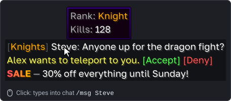
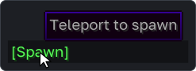
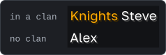

<div align="center">

# GikyMessage

**Compile once. Render forever.**

Write rich Minecraft messages — colors, gradients, clickable buttons, hover cards — as short strings
that stay readable in a config file. GikyMessage turns them into
[Adventure](https://docs.papermc.io/adventure/text/) components, fast.

[](https://jitpack.io/#groundbreakingmc/GikyMessage)
[](#installation)
[](LICENSE)

**English** · [Русский](README_RU.md)

</div>

<p align="center">
  
</p>

All it takes is three lines in a plugin's config:

```yaml
# messages.yml of a plugin that uses GikyMessage
chat: '[&8\[&6{clan}&8\] ](if:{clan})[&f{player}](show:&7Rank: &6{rank}\n&7Kills: &f{kills}, suggest:/msg {player} )&7: &f{message}'
tpa: '&e{player} wants to teleport to you. [&a\[Accept\]](run:/tpaccept {player}, show:&aClick to accept) [&c\[Deny\]](run:/tpdeny {player})'
sale: '[&lSALE](color:#ff5555-#ffaa00) &7— &f30% off everything until Sunday!'
```

## Why GikyMessage

- **Readable in a config.** The `&` codes everyone knows, plus `[text](action)` for parts that react
  to clicks and hovers. There are no closing tags to forget.
- **Safe with player input.** Values in `{placeholders}` are inserted as plain text. A nickname like
  `&kTroll`, or a chat message that contains `[click](run:/op me)`, can't change your formatting.
- **Fast.** A template is parsed once, when your plugin loads. Sending a message only fills in the
  values, and a [binding](wiki/java-api.md#the-same-player-again-and-again-bind) skips even that
  work while nothing has changed.
- **Plain Adventure.** The result is an ordinary Adventure `Component`, so it works on Paper,
  Velocity and [any other platform](https://docs.papermc.io/adventure/platform/) that uses
  Adventure.

## Where to start

| You are… | Read |
|---|---|
| Writing messages for a server | [Quick start: your first message in 5 minutes](wiki/quick-start.md), then keep the [cheat sheet](wiki/cheatsheet.md) at hand |
| Building a plugin | [Installation](#installation) below, then the [Java API guide](wiki/java-api.md) |
| Looking at a message that doesn't work | [Troubleshooting](wiki/troubleshooting.md) |
| Asking an AI assistant to write messages or convert them | [`llms.txt`](llms.txt): the whole format and the rules for converting MiniMessage and `&` codes, in one file |

> [!TIP]
> **Moving from MiniMessage?** Send your AI assistant the file [`llms.txt`](llms.txt) or its link,
> `https://raw.githubusercontent.com/groundbreakingmc/GikyMessage/main/llms.txt`, paste your
> messages and ask: *"Convert these to GikyMessage."*

## The format at a glance

| You write | Players see |
|---|---|
| `&aGreen &#ff8800orange &lbold` |  |
| `&7Hello, &f{player}&7!` |  |
| `[&a\[Spawn\]](run:/spawn, show:&7Teleport to spawn)` |  |
| `[Skyblock Season 3](color:#55ffff-#5555ff)` |  |
| `[&6{clan} ](if:{clan})&f{player}` |  |
| `&7Balance: &e[{balance}](transform:compact)` |  |

Each line links to the full story: [colors](wiki/colors.md), [placeholders](wiki/placeholders.md),
[segments](wiki/segments.md), [gradients](wiki/gradients.md), [conditions](wiki/conditions.md),
[transforms](wiki/transforms.md).

## Installation

GikyMessage needs **Java 21** and the **Adventure API**. Paper, Velocity and other Adventure
platforms already ship Adventure, so you declare it as `compileOnly` and don't bundle it.

The library comes from [JitPack](https://jitpack.io/#groundbreakingmc/GikyMessage). Put the latest
version from this badge in place of `VERSION`:
[](https://jitpack.io/#groundbreakingmc/GikyMessage)

<details open>
<summary><b>Gradle (Kotlin DSL)</b></summary>

```kotlin
repositories {
    maven("https://jitpack.io")
}

dependencies {
    implementation("com.github.groundbreakingmc:GikyMessage:VERSION")
    compileOnly("net.kyori:adventure-api:5.2.0") // or your platform's API, which includes it
}
```

</details>

<details>
<summary><b>Gradle (Groovy DSL)</b></summary>

```groovy
repositories {
    maven { url 'https://jitpack.io' }
}

dependencies {
    implementation 'com.github.groundbreakingmc:GikyMessage:VERSION'
    compileOnly 'net.kyori:adventure-api:5.2.0'
}
```

</details>

<details>
<summary><b>Maven</b></summary>

```xml
<repositories>
    <repository>
        <id>jitpack.io</id>
        <url>https://jitpack.io</url>
    </repository>
</repositories>

<dependencies>
    <dependency>
        <groupId>com.github.groundbreakingmc</groupId>
        <artifactId>GikyMessage</artifactId>
        <version>VERSION</version>
    </dependency>
    <dependency>
        <groupId>net.kyori</groupId>
        <artifactId>adventure-api</artifactId>
        <version>5.2.0</version>
        <scope>provided</scope>
    </dependency>
</dependencies>
```

</details>

> [!IMPORTANT]
> GikyMessage is a library, not a server plugin: it goes **inside** your plugin's jar. Bundle it
> with the [Shadow plugin](https://gradleup.com/shadow/) (`com.gradleup.shadow`) and [relocate
> it](https://gradleup.com/shadow/configuration/relocation/), so that two plugins with different
> GikyMessage versions don't collide:
>
> ```kotlin
> tasks.shadowJar {
>     relocate("com.github.groundbreakingmc.gikymessage", "com.example.myplugin.libs.gikymessage")
> }
> ```

It is built against Adventure 5.2.0 and also runs on older Adventure versions. A few features need a
newer one; see [version requirements](wiki/java-api.md#version-requirements).

## Java in 30 seconds

```yaml
# config.yml
join: '&8\[&a+&8\] &7{player} joined the server'
```

```java
public final class WelcomePlugin extends JavaPlugin implements Listener {

    private Text<Player> joinMessage;

    @Override
    public void onEnable() {
        saveDefaultConfig();
        // Parse the template once, when the plugin starts.
        joinMessage = Text.of(getConfig().getString("join"), key -> switch (key) {
            case "player" -> (player, value) -> value.text(player.getName());
            default -> null; // unknown placeholders stay visible as {key}
        });
        getServer().getPluginManager().registerEvents(this, this);
    }

    @EventHandler
    public void onJoin(PlayerJoinEvent event) {
        // Each join only fills in the value.
        event.joinMessage(joinMessage.render(event.getPlayer()));
    }
}
```

![\[+\] Steve joined the server](wiki/images/en/readme-join.svg)

The [Java API guide](wiki/java-api.md) covers the rest: other value types, formatted prefixes,
bindings for scoreboards and action bars, threads and errors.

## Documentation

| | |
|---|---|
| **Learn** | [Quick start](wiki/quick-start.md) · [Cheat sheet](wiki/cheatsheet.md) |
| **Format** | [Colors and styles](wiki/colors.md) · [Placeholders](wiki/placeholders.md) · [Segments](wiki/segments.md) · [Gradients](wiki/gradients.md) · [Conditions](wiki/conditions.md) · [Translations](wiki/translations.md) · [Transforms](wiki/transforms.md) · [Escaping](wiki/escapes.md) |
| **Practice** | [Recipes](wiki/recipes.md) · [Troubleshooting](wiki/troubleshooting.md) |
| **Develop** | [Java API](wiki/java-api.md) |
| **For AI** | [llms.txt](llms.txt): the format and the MiniMessage conversion rules in one file for AI assistants |

## License

[Apache License 2.0](LICENSE)
