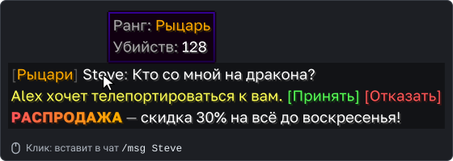

<div align="center">

# GikyMessage

**Скомпилируй раз. Рендери вечно.**

Пишите красивые сообщения для Minecraft — с цветами, градиентами, кнопками и подсказками при
наведении — короткими строками, которые легко читать прямо в конфиге. GikyMessage быстро превращает
их в компоненты [Adventure](https://docs.papermc.io/adventure/text/).

[](https://jitpack.io/#groundbreakingmc/GikyMessage)
[](#установка)
[](LICENSE)

[English](README.md) · **Русский**

</div>

<p align="center">
  
</p>

Для этого достаточно трёх строк в конфиге плагина:

```yaml
# messages.yml плагина, который использует GikyMessage
chat: '[&8\[&6{clan}&8\] ](if:{clan})[&f{player}](show:&7Ранг: &6{rank}\n&7Убийств: &f{kills}, suggest:/msg {player} )&7: &f{message}'
tpa: '&e{player} хочет телепортироваться к вам. [&a\[Принять\]](run:/tpaccept {player}, show:&aПринять запрос) [&c\[Отказать\]](run:/tpdeny {player})'
sale: '[&lРАСПРОДАЖА](color:#ff5555-#ffaa00) &7— &fскидка 30% на всё до воскресенья!'
```

## Почему GikyMessage

- **Читается прямо в конфиге.** Привычные всем `&`-коды и `[текст](действие)` для частей, которые
  реагируют на клик и наведение. Никаких закрывающих тегов, которые легко забыть.
- **Безопасно с вводом игроков.** Значения `{плейсхолдеров}` вставляются как обычный текст. Ник
  вроде `&kTroll` или сообщение в чате с `[click](run:/op me)` ничего не сломают в оформлении.
- **Быстро.** Шаблон разбирается один раз, при загрузке плагина. При отправке сообщения
  подставляются только значения, а
  [привязка](wiki/ru/java-api.md#один-и-тот-же-игрок-снова-и-снова-bind) пропускает даже эту работу,
  пока ничего не поменялось.
- **Обычный Adventure.** На выходе — обычный `Component` из Adventure: он работает на Paper,
  Velocity и [любой другой платформе](https://docs.papermc.io/adventure/platform/) с Adventure.

## С чего начать

| Вы… | Читайте |
|---|---|
| Пишете сообщения для сервера | [Быстрый старт: первое сообщение за 5 минут](wiki/ru/quick-start.md), а под рукой держите [шпаргалку](wiki/ru/cheatsheet.md) |
| Разрабатываете плагин | [Установку](#установка) ниже, затем [руководство по Java API](wiki/ru/java-api.md) |
| Смотрите на сообщение, которое работает не так | [Частые проблемы](wiki/ru/troubleshooting.md) |
| Просите ИИ-ассистента написать сообщения или переделать старые | [`llms.txt`](llms.txt): весь формат и правила перехода с MiniMessage и `&`-кодов в одном файле |

> [!TIP]
> **Переходите с MiniMessage?** Отправьте ИИ-ассистенту файл [`llms.txt`](llms.txt) или ссылку на
> него, `https://raw.githubusercontent.com/groundbreakingmc/GikyMessage/main/llms.txt`, вставьте
> свои сообщения и попросите: *«Переделай их в формат GikyMessage»*. Файл написан на английском —
> это не мешает ИИ отвечать вам по-русски.

## Формат с первого взгляда

| Вы пишете | Игроки видят |
|---|---|
| `&aЗелёный &#ff8800оранжевый &lжирный` |  |
| `&7Привет, &f{player}&7!` |  |
| `[&a\[Спавн\]](run:/spawn, show:&7Телепорт на спавн)` |  |
| `[Скайблок, 3 сезон](color:#55ffff-#5555ff)` |  |
| `[&6{clan} ](if:{clan})&f{player}` |  |
| `&7Баланс: &e[{balance}](transform:compact)` |  |

Подробно о каждой строке: [цвета](wiki/ru/colors.md), [плейсхолдеры](wiki/ru/placeholders.md),
[сегменты](wiki/ru/segments.md), [градиенты](wiki/ru/gradients.md),
[условия](wiki/ru/conditions.md), [преобразования](wiki/ru/transforms.md).

## Установка

GikyMessage нужны **Java 21** и **Adventure API**. Paper, Velocity и другие платформы уже содержат
Adventure, поэтому его подключают как `compileOnly` и не кладут в свой jar.

Сама библиотека берётся с [JitPack](https://jitpack.io/#groundbreakingmc/GikyMessage). Вместо
`VERSION` подставьте последнюю версию с этого значка:
[](https://jitpack.io/#groundbreakingmc/GikyMessage)

<details open>
<summary><b>Gradle (Kotlin DSL)</b></summary>

```kotlin
repositories {
    maven("https://jitpack.io")
}

dependencies {
    implementation("com.github.groundbreakingmc:GikyMessage:VERSION")
    compileOnly("net.kyori:adventure-api:5.2.0") // или API вашей платформы, в нём он уже есть
}
```

</details>

<details>
<summary><b>Gradle (Groovy DSL)</b></summary>

```groovy
repositories {
    maven { url 'https://jitpack.io' }
}

dependencies {
    implementation 'com.github.groundbreakingmc:GikyMessage:VERSION'
    compileOnly 'net.kyori:adventure-api:5.2.0'
}
```

</details>

<details>
<summary><b>Maven</b></summary>

```xml
<repositories>
    <repository>
        <id>jitpack.io</id>
        <url>https://jitpack.io</url>
    </repository>
</repositories>

<dependencies>
    <dependency>
        <groupId>com.github.groundbreakingmc</groupId>
        <artifactId>GikyMessage</artifactId>
        <version>VERSION</version>
    </dependency>
    <dependency>
        <groupId>net.kyori</groupId>
        <artifactId>adventure-api</artifactId>
        <version>5.2.0</version>
        <scope>provided</scope>
    </dependency>
</dependencies>
```

</details>

> [!IMPORTANT]
> GikyMessage — библиотека, а не плагин для сервера: она живёт **внутри** jar вашего плагина.
> Упакуйте её туда плагином [Shadow](https://gradleup.com/shadow/) (`com.gradleup.shadow`) и
> [перенесите в свой пакет](https://gradleup.com/shadow/configuration/relocation/), чтобы два
> плагина с разными версиями GikyMessage не мешали друг другу:
>
> ```kotlin
> tasks.shadowJar {
>     relocate("com.github.groundbreakingmc.gikymessage", "com.example.myplugin.libs.gikymessage")
> }
> ```

Библиотека собрана под Adventure 5.2.0 и работает и на более старых версиях. Некоторым возможностям
нужна версия поновее — см. [требования к версиям](wiki/ru/java-api.md#требования-к-версиям).

## Java за 30 секунд

```yaml
# config.yml
join: '&8\[&a+&8\] &7{player} зашёл на сервер'
```

```java
public final class WelcomePlugin extends JavaPlugin implements Listener {

    private Text<Player> joinMessage;

    @Override
    public void onEnable() {
        saveDefaultConfig();
        // Шаблон разбирается один раз, при запуске плагина.
        joinMessage = Text.of(getConfig().getString("join"), key -> switch (key) {
            case "player" -> (player, value) -> value.text(player.getName());
            default -> null; // неизвестные плейсхолдеры остаются в тексте как {key}
        });
        getServer().getPluginManager().registerEvents(this, this);
    }

    @EventHandler
    public void onJoin(PlayerJoinEvent event) {
        // При каждом входе только подставляется значение.
        event.joinMessage(joinMessage.render(event.getPlayer()));
    }
}
```

![\[+\] Steve зашёл на сервер](wiki/images/ru/readme-join.svg)

Остальное — в [руководстве по Java API](wiki/ru/java-api.md): другие типы значений,
отформатированные префиксы, привязки для скорборда и экшенбара, потоки и ошибки.

## Документация

| | |
|---|---|
| **Знакомство** | [Быстрый старт](wiki/ru/quick-start.md) · [Шпаргалка](wiki/ru/cheatsheet.md) |
| **Формат** | [Цвета и стили](wiki/ru/colors.md) · [Плейсхолдеры](wiki/ru/placeholders.md) · [Сегменты](wiki/ru/segments.md) · [Градиенты](wiki/ru/gradients.md) · [Условия](wiki/ru/conditions.md) · [Переводы](wiki/ru/translations.md) · [Преобразования](wiki/ru/transforms.md) · [Экранирование](wiki/ru/escapes.md) |
| **Практика** | [Рецепты](wiki/ru/recipes.md) · [Частые проблемы](wiki/ru/troubleshooting.md) |
| **Разработка** | [Java API](wiki/ru/java-api.md) |
| **Для ИИ** | [llms.txt](llms.txt): формат и правила перехода с MiniMessage в одном файле для ИИ-ассистентов |

## Лицензия

[Apache License 2.0](LICENSE)
