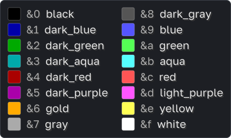

# Cheat sheet

**English** · [Русский](ru/cheatsheet.md) · [← Documentation](README.md)

The whole format on one page. Each heading links to the full page.

## [Colors and styles](colors.md)

| Write | Result |
|---|---|
| `&0`…`&9`, `&a`…`&f` | One of the [16 colors](colors.md#the-16-colors) |
| `&#ff8800`, `#ff8800` | Any color (hex), always six digits |
| `&l` `&o` `&n` `&m` `&k` | Bold, italic, underlined, strikethrough, obfuscated |
| `&r` | Reset to plain text |
| `$#000000`, `$#000000:80`, `$#000000:00` | Shadow color, with transparency, no shadow *(1.21.4+)* |

A color code ends styles and the shadow, so write the color first: `&6&l` is bold gold,
`&f$#ff5555` is white with a red shadow. `&r` resets to plain text; brackets keep a style inside
them: `&a[&lTitle] rest`.

`#` or `$` followed by six hex digits is always a code. To show such text, as in a ticket number or
a price, put a backslash in front: `\#123456`, `\$100000`.



## [Placeholders](placeholders.md)

| Write | Result |
|---|---|
| `{player}` | The value the plugin provides; unknown names stay as `{player}` |

Values are shown exactly as they are: `&c` inside a value isn't a color.

## [Segments](segments.md)

`[text](action:value, action:value)` — `text` gets the actions; its style stays inside the brackets.

| Action | Does |
|---|---|
| `run:/spawn` | Runs a command on click |
| `suggest:/msg Steve ` | Types text into the chat box on click |
| `url:https://example.com` | Opens a link on click |
| `copy:play.example.com` | Copies text on click |
| `page:2` | Turns a book page on click |
| `show:&7Tooltip\nSecond line` | Tooltip |
| `insert:text` | Inserts text on Shift+click |
| `head:{player}` | Player head *(1.21.9+)* |
| `sprite:myserver:icons/coin` | Texture *(1.21.9+)* |
| `font:uniform` | Another font |
| `color:red`, `style:"gold bold $#000000"`, `shadow:#000000:80` | Color, style and shadow where the segment's text sets none |
| `force-color:red`, `force-style:"gold bold"`, `force-shadow:none` | The same, over everything inside the segment |
| `color:#ff5555-#5555ff`, `phase:0.5` | [Gradient](gradients.md), shifted along the text |
| `if:{clan}`, `unless:{clan}`, `if:{group}==vip`, `if:{level}>=10` | [Conditions](conditions.md) |
| `lang:item.minecraft.diamond` | [Translation](translations.md) to the player's language |
| `transform:compact`, `transform:"upper max:10"` | [Transforms](transforms.md) |

- Separate actions with commas; quote values that contain a comma or `)`: `run:"/say a, b"`.
- Inside quotes write `\"` for a quote; `\n` and the other escapes work as everywhere.
- One click action per segment. Unknown actions are ignored.

## [Conditions](conditions.md)

| Write | Shown |
|---|---|
| `[{clan} ](if:{clan})` | While `{clan}` has text |
| `[no clan](unless:{clan})` | While `{clan}` is empty |
| `[VIP](if:{group}==vip)`, `(if:{group}!=vip)` | When the values are equal / different |
| `[Pro](if:{level}>=10)`, also `>` `<` `<=` | When the number is at least 10 |
| `(if:{a} && {b})`, `(if:{a} \|\| {b})` | When both hold / either holds |
| `[Yes\|No](if:{x})` | First branch if the condition holds, otherwise the second |
| `[A\|B\|C](if:{x}==1, if:{x}==2)` | A, B, or C as the fallback |

Keep spaces inside a hidden segment: `[{clan} ](if:{clan}){player}`.

## [Transforms](transforms.md)

`compact` (1234567 → 1.2M) · `upper` · `lower` · `smallcaps` (ꜱᴛᴇᴠᴇ) · `max:N`

## [Escaping](escapes.md)

| Write | Get |
|---|---|
| `\[` `\]` `\{` `\}` `\\` | `[` `]` `{` `}` `\` |
| `\n` | Line break |
| `\\|` | `\|` inside a segment with a condition |
| `\&` `\#` `\$` | `&` `#` `$` where they would start a code: `R\&D`, `\$100000` |

## YAML

```yaml
message: '&8\[&6VIP&8\] &7Don''t forget to vote!'   # single quotes; '' for an apostrophe
```

[Single quotes](https://yaml.org/spec/1.2.2/#732-single-quoted-style) keep backslashes as they are.
