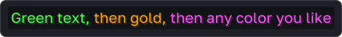
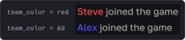

# Colors and styles

**English** · [Русский](ru/colors.md) · [← Documentation](README.md)

Put `&` and a code in front of the text. A **color** lasts until the next color; a **style** such as
bold lasts until `&r`.

```text
&aGreen text, &6then gold, &#ff55ffthen any color you like
```



**On this page:** [the 16 colors](#the-16-colors) · [hex colors](#any-color-hex-codes) ·
[styles](#styles) · [turning a style off](#turning-a-style-off) · [text shadow](#text-shadow) ·
[color as an action](#coloring-one-part-color-and-style)

## The 16 colors


| Code | Name | Code | Name |
|---|---|---|---|
| `&0` | `black` | `&8` | `dark_gray` |
| `&1` | `dark_blue` | `&9` | `blue` |
| `&2` | `dark_green` | `&a` | `green` |
| `&3` | `dark_aqua` | `&b` | `aqua` |
| `&4` | `dark_red` | `&c` | `red` |
| `&5` | `dark_purple` | `&d` | `light_purple` |
| `&6` | `gold` | `&e` | `yellow` |
| `&7` | `gray` | `&f` | `white` |

You need the names for the [`color` action](#coloring-one-part-color-and-style). Codes also work in
upper case: `&A` is the same as `&a`.

## Any color: hex codes

`&#` followed by six hex digits gives any color. The `&` is optional, so `#ff8800` is the same
code:

```text
&#ff8800Orange &#00aaffsky blue #ff66ccpink
```


A code is always exactly six digits, so the text after it can start with any character:
`&#ff8800Bad` is the word "Bad" in orange. Shorter codes such as `&#f80` aren't codes and stay as
text.

A `#` followed by six digits or letters from `a` to `f` is a color even where you mean it as text,
for example in a ticket number. Put a backslash in front to show it: `\#123456`.

## Styles

| Code | Style |
|---|---|
| `&l` | **Bold** |
| `&o` | *Italic* |
| `&n` | Underlined |
| `&m` | ~~Strikethrough~~ |
| `&k` | Obfuscated: random characters that keep changing |
| `&r` | Reset: plain text again, without color or style |

```text
&lBold&r &oItalic&r &nUnderlined&r &mStrikethrough&r &kObfuscated
```


Styles add up: `&l&n` is bold and underlined, and the order of codes doesn't matter, so `&l&c` and
`&c&l` both give bold red.

## Turning a style off

A new color doesn't end bold, italic or any other style. [Classic `§`
codes](https://minecraft.wiki/w/Formatting_codes#Java_Edition), and many plugins that copy them,
behave differently, so it's worth remembering. End a style with `&r`, or keep it inside square
brackets:

```text
&f&lSkyCraft &7— survival server
&f&lSkyCraft&r &7— survival server
[&f&lSkyCraft] &7— survival server
```


In the first line everything after `&l` is bold, gray part included. The second line resets after
the name. The third one keeps the style inside the brackets, which is often shorter, because after
`]` the text continues in the color and style it had before `[`.

## Text shadow

Minecraft draws a darker copy of the text under it. `$#` and six hex digits set the color of that
shadow. The `#` is optional here, so `$ff5555` is the same code:

```text
$#ff5555&fRed shadow   $#5555ff:80&fHalf-transparent blue   $#000000:00&fNo shadow
```


| You write | Shadow |
|---|---|
| `$#RRGGBB`, `$RRGGBB` | Fully visible, in that color |
| `$#RRGGBB:AA` | The two digits after the colon are transparency: `00` invisible, `80` half, `ff` fully visible |
| `$#000000:00` | No shadow at all |

A `$` followed by six digits is a shadow even where you mean a price. Put a backslash in front to
show it as text: `\$100000`.

> [!NOTE]
> Players see [custom shadows](https://minecraft.wiki/w/Text_component_format#Java_Edition) on
> Minecraft 1.21.4 and newer; older clients draw the usual shadow. The server needs Adventure 4.18
> or newer, otherwise the message fails to load with an error that says so.

## Coloring one part: `color` and `style`

[Segments](segments.md) can set the color and style of their text with an action. It does the same
as `&` codes, but the value can come from a placeholder, for example a team color:

```text
[{player}](color:{team_color}) &7joined the game
```



`color:` takes one color in any form: `red`, `c`, `&c`, `#ff5555` or `&#ff5555`. `style:` takes
several values separated by spaces: colors, the words `bold`, `italic`, `underlined`,
`strikethrough`, `obfuscated` and `reset`, or `&` codes:

```text
[Event starts now!](style:"gold bold")
[Event starts now!](style:&6&l)
```

If the value isn't valid — for example, the placeholder is empty — the text keeps the colors it
already had. When a segment has both, `color` wins over the color in `style`.

## For developers

A color placeholder is reported as text, in any of the forms above:

```java
case "team_color" -> (player, value) -> value.text(teamOf(player).colorCode()); // "&c", "red", "#ff5555"…
```

---

[← Quick start](quick-start.md) · [Documentation](README.md) · [Placeholders →](placeholders.md)
