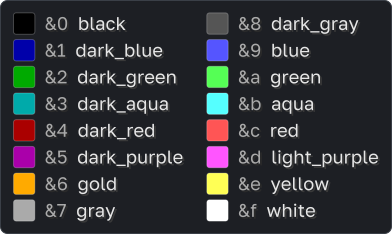
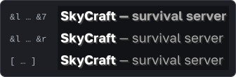

# Colors and styles

**English** · [Русский](ru/colors.md) · [← Documentation](README.md)

Put `&` and a code in front of the text. A **color** lasts until the next color; a **style** such as
bold lasts until `&r`.

```text
&aGreen text, &6then gold, &#ff55ffthen any color you like
```


**On this page:** [the 16 colors](#the-16-colors) · [hex colors](#any-color-hex-codes) ·
[styles](#styles) · [turning a style off](#turning-a-style-off) · [text shadow](#text-shadow) ·
[color as an action](#coloring-one-part-color-and-style)

## The 16 colors



| Code | Name | Code | Name |
|---|---|---|---|
| `&0` | `black` | `&8` | `dark_gray` |
| `&1` | `dark_blue` | `&9` | `blue` |
| `&2` | `dark_green` | `&a` | `green` |
| `&3` | `dark_aqua` | `&b` | `aqua` |
| `&4` | `dark_red` | `&c` | `red` |
| `&5` | `dark_purple` | `&d` | `light_purple` |
| `&6` | `gold` | `&e` | `yellow` |
| `&7` | `gray` | `&f` | `white` |

You need the names for the [`color` action](#coloring-one-part-color-and-style). Codes also work in
upper case: `&A` is the same as `&a`.

## Any color: hex codes

`&#` followed by six hex digits gives any color. The `&` is optional, so `#ff8800` is the same
code:

```text
&#ff8800Orange &#00aaffsky blue #ff66ccpink
```


A code is always exactly six digits, so the text after it can start with any character:
`&#ff8800Bad` is the word "Bad" in orange. Shorter codes such as `&#f80` aren't codes and stay as
text.

A `#` followed by six digits or letters from `a` to `f` is a color even where you mean it as text,
for example in a ticket number. Put a backslash in front to show it: `\#123456`.

## Styles

| Code | Style |
|---|---|
| `&l` | **Bold** |
| `&o` | *Italic* |
| `&n` | Underlined |
| `&m` | ~~Strikethrough~~ |
| `&k` | Obfuscated: random characters that keep changing |
| `&r` | Reset: plain text again, without color or style |

```text
&lBold&r &oItalic&r &nUnderlined&r &mStrikethrough&r &kObfuscated
```


Styles add up: `&l&n` is bold and underlined. Write the color first and the styles after it: a color
code ends styles, so `&c&l` gives bold red, while `&l&c` gives plain red.

## Turning a style off

A color code ends bold, italic and every other style, as [classic `§`
codes](https://minecraft.wiki/w/Formatting_codes#Java_Edition) do. That's true for `&0`–`&f`,
`&#rrggbb` and a bare `#rrggbb`: the text after them is regular, in the new color. To end a style
without a new color, use `&r`, or keep the style inside square brackets:

```text
&f&lSkyCraft &7— survival server
&f&lSkyCraft&r &7— survival server
[&f&lSkyCraft] &7— survival server
```



In the first line `&7` ends the bold. In the second `&r` ends it and resets the text to plain white,
then `&7` makes it gray. The third one keeps the style inside the brackets: after `]` the text
continues in the color and style it had before `[`. That's handy when the text after the styled part
has no color code of its own, as in `&a[&lSkyCraft] welcomes you`.

## Text shadow

Minecraft draws a darker copy of the text under it. `$#` and six hex digits set the color of that
shadow. The `#` is optional here, so `$ff5555` is the same code:

```text
&f$#ff5555Red shadow   &f$#5555ff:80Half-transparent blue   &f$#000000:00No shadow
```


| You write | Shadow |
|---|---|
| `$#RRGGBB`, `$RRGGBB` | Fully visible, in that color |
| `$#RRGGBB:AA` | The two digits after the colon are transparency: `00` invisible, `80` half, `ff` fully visible |
| `$#000000:00` | No shadow at all |

Write the shadow after the color, like a style: a color code ends the custom shadow. So
`&f$#ff5555Text` is white with a red shadow, while `$#ff5555&fText` has the usual shadow. `&r` ends
it too.

A `$` followed by six digits is a shadow even where you mean a price. Put a backslash in front to
show it as text: `\$100000`.

> [!NOTE]
> Players see [custom shadows](https://minecraft.wiki/w/Text_component_format#Java_Edition) on
> Minecraft 1.21.4 and newer; older clients draw the usual shadow. The server needs Adventure 4.18
> or newer, otherwise the message fails to load with an error that says so.

## Coloring one part: `color` and `style`

[Segments](segments.md) can set the color and style of their text with an action. The value can come
from a placeholder, for example a team color:

```text
[{player}](color:{team_color}) &7joined the game
```


`color:` takes one color in any form: `red`, `c`, `&c`, `#ff5555` or `&#ff5555`, or a
[gradient](gradients.md): colors joined by `-`, such as `#ff5555-#5555ff`. `style:` takes several
values separated by spaces: colors and gradients, the words `bold`, `italic`, `underlined`,
`strikethrough`, `obfuscated` and `reset`, `&` codes, or a [shadow](#text-shadow) such as
`$#000000:80`:

```text
[Event starts now!](style:"gold bold")
[Event starts now!](style:&6&l)
[Event starts now!](style:"gold $#000000:80")
```

`shadow:` sets only the shadow, so its placeholder needs no `$`. It takes a shadow as text writes
it, with or without `$` and `#`, such as `#ff5555` or `$#ff5555:80`, `none` for no shadow, or a
[shadow gradient](gradients.md#shadow-gradients) such as `#000000-#333333`:

```text
[{player}](shadow:{team_shadow})
[Event starts now!](shadow:#000000:80)
```

These actions only fill what the segment's own text leaves unset. They replace the look the segment
gets from codes before it, but codes inside the segment and the colors of parts that placeholders
insert, such as a colored prefix or a highlighted mention, stay as they are:

```text
&7[{message}](style:gold)   the message is gold, not gray
&a[&bText](color:red)       Text stays aqua
```

`reset` in `style:` resets the shadow as well. If the value isn't valid — for example, the
placeholder is empty — the segment keeps the look it had before it. When a segment has several,
`color` wins over the color in `style`, and `shadow` over its shadow.

### Overriding everything: `force-color`, `force-style`, `force-shadow`

To give the whole segment one look no matter what's inside, use the forced versions. They take the
same values as `color:`, `style:` and `shadow:`, and override codes inside the segment and the parts
that placeholders insert:

```text
[&bText](force-color:red)                       Text is red
[{prefix} {player}](force-style:"gray italic")  all gray and italic, the colored prefix too
```

A forced action wins over a plain one: `[Text](color:red, force-color:blue)` is blue. A forced
[gradient](gradients.md#colors-inside-the-segment) colors every letter, too.
`force-style:reset` also removes every shadow inside the segment.

Shadow actions need Adventure 4.18 or newer, like [shadow codes](#text-shadow). Where the server has
no shadow colors, a fixed shadow makes the message fail to load with an error, and a shadow from a
placeholder is left out while the rest of the style still applies.

## For developers

A color placeholder is reported as text, in any of the forms above, a gradient included:

```java
case "team_color" -> (player, value) -> value.text(teamOf(player).colorCode()); // "&c", "red", "#ff5555"…
```

---

[← Quick start](quick-start.md) · [Documentation](README.md) · [Placeholders →](placeholders.md)
