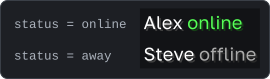
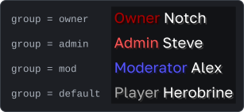

# Conditions

[← Documentation](README.md)

Conditions show a [segment](segments.md) only in some cases: a clan tag only for players in a clan,
a VIP badge only for VIPs, "online" or "offline" depending on the status.

```text
[&8\[&6{clan}&8\] ](if:{clan})&f{player}
```

![With a clan the tag \[Knights\] is shown before the name; without a clan only the name is
shown](images/en/cond-intro.svg)

## Show or hide: `if` and `unless`

`if:{value}` shows the segment while the value has some text. `unless:{value}` does the opposite and
shows it while the value is empty:

```text
[&8\[&6{clan}&8\] ](if:{clan})&f{player}
&f{player}[ &7(no clan)](unless:{clan})
```

| `{clan}` | First line | Second line |
|---|---|---|
| `Knights` | `[Knights] Steve` | `Steve` |
| *(empty)* | `Steve` | `Steve (no clan)` |

A value made only of spaces counts as empty. A hidden segment leaves nothing behind, so keep the
spaces that belong to it **inside** the brackets, as in `[… ](if:…)` above; otherwise an empty clan
leaves a stray space before the name.

## Compare: `==` and `!=`

A condition can compare two values, or a value with fixed text:

```text
[&6\[VIP\] ](if:{group}==vip)&f{player}
[&7(away) ](if:{status}!=online)&f{player}
```

![A \[VIP\] badge only for the vip group, and (away) for a player whose status isn't
online](images/en/cond-compare.svg)

Spaces around the values don't matter. Upper and lower case do: `VIP` isn't the same as `vip`. Two
numbers are compared by value, so `10.0` equals `10`.

## Otherwise: `|`

Inside a segment with a condition, `|` splits the text into branches. The first branch is shown when
the condition holds, the second one otherwise:

```text
&f{friend} [&aonline|&7offline](if:{status}==online)
```



Several conditions choose among several branches, in order: the first condition decides about the
first branch, the second about the second, and the last branch is the fallback when none of them
holds:

```text
[&4Owner|&cAdmin|&9Moderator|&7Player](if:{group}==owner, if:{group}==admin, if:{group}==mod) &f{player}
```



The other actions of the segment apply to whichever branch is shown, so `[A|B](if:{x}, run:/cmd)`
runs `/cmd` in both cases.

## Numbers: `<`, `>`, `<=`, `>=`

These compare numbers, so a message can react to a ping, a level or a balance:

```text
&7Ping: [&a{ping} ms|&e{ping} ms|&c{ping} ms](if:{ping}<100, if:{ping}<250)
```


A number can have a minus and a decimal point: `-5`, `2.5`. When a side isn't a number, for example
an empty value or `1,000`, the comparison doesn't hold.

## Combining conditions: `&&` and `||`

`&&` means "and", `||` means "or":

```text
[&6\[VIP\] ](if:{group}==vip || {group}==mvp)&f{player}
[&a\[Claim\]](if:{level}>=10 && {claimed}!=yes, run:/reward claim)
```

`&&` binds tighter, so `{a} || {b} && {c}` means "a, or both b and c". There are no parentheses; for
more complex logic, put a segment inside a segment.

`unless` turns the whole condition around, and `if` and `unless` in one segment must both hold:

| You want | Write |
|---|---|
| A **and** B | `if:{a} && {b}` |
| A **or** B | `if:{a} \|\| {b}` |
| **Not** A | `unless:{a}` |
| A **and not** B | `if:{a}, unless:{b}` |
| **Neither** A **nor** B | `unless:{a} \|\| {b}` |

For example, a VIP badge that disappears while the player is vanished:

```text
[&6\[VIP\] ](if:{vip}, unless:{vanished})&f{player}
```

Without branches, a segment uses only its **last** `if` and its last `unless`, so
`[…](if:{a}, if:{b})` checks just `{b}`. Join them with `&&` instead.

## Writing rules

- In a segment without a condition, `|` is ordinary text. In a segment with one, write `\|` for a
  `|` that shouldn't split it.
- A condition without placeholders is decided when the message loads: `[x](if:yes)` is always shown,
  and `[x](if:a==b)` never is.
- A placeholder that the plugin doesn't know stays `{name}`, which is text, so `if:{unknown}` always
  holds.
- Operators are read from the message, never from values: a value like `x || y` is just text.
- Equality takes two signs, `==`. A single `=` is ordinary text, so `if:{group}=vip` compares
  nothing and always holds.

## For developers

Conditions look at the reported values:

- empty text, spaces only, and components that hold only formatting count as empty;
- numbers always count as text, `0` included;
- a missing value renders as `{key}` and therefore counts as text;
- comparisons use the plain text of both sides, so a component `Component.text("5")` equals the
  number `5`;
- `<`, `>`, `<=` and `>=` work with numbers reported in any way: `value.number(42)`,
  `value.text("2.5")` or a component.

---

[← Gradients](gradients.md) · [Documentation](README.md) · [Translations →](translations.md)
