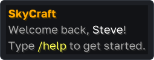

# Escaping and quotes

**English** · [Русский](ru/escapes.md) · [← Documentation](README.md)

A few characters have a job in the format: `[` and `]` make [segments](segments.md), `{` and `}`
make [placeholders](placeholders.md). To show them as plain text, put a backslash in front:

```text
&8\[&6VIP&8\] &f{player}&7: &fHi!
```

![\[VIP\] Steve: Hi! with visible square brackets](images/en/esc-brackets.svg)

| You write | You get |
|---|---|
| `\[` and `\]` | `[` and `]` |
| `\{` and `\}` | `{` and `}` |
| `\\|` | `\|` inside a segment with a [condition](conditions.md#otherwise-), where `\|` alone would split it |
| `\\` | `\` |
| `\&`, `\#` and `\$` | `&`, `#` and `$` where they would start a [color or shadow code](colors.md) |
| `\n` | A line break |

## Line breaks

`\n` starts a new line, which is handy for multi-line announcements and tooltips:

```text
&6&lSkyCraft&r\n&7Welcome back, &f{player}&7!\n&7Type &e/help &7to get started.
```



## What happens without a backslash

- `[` always starts a segment, even in a smiley: `:-[` loses its bracket, because it opens a segment
  that is never closed. Write `:-\[`.
- `]` without an open `[` is ordinary text, and so is `{` without a matching `}`.
- `&`, `#` and `$` followed by something that isn't a code stay as they are: `Tom & Jerry`, `#1`,
  `$5`.
- Where they would start a code, they need the backslash: `R&D` loses its `&D`, which is the code of
  a color, and `$100000` is read as a shadow. Write `R\&D` and `\$100000`.

## Quotes inside actions

A comma separates actions, so a value that contains a comma goes in quotes, `"…"` or `'…'`:

```text
[&e\[?\]](show:"&6Rules\n&71. Be nice, no spam, no ads\n&72. No cheats")
```

Inside quotes `\n`, `\[` and the other escapes work as without them, and spaces at the ends are
kept. Only a quote needs a backslash there: `\"` or `\'`.

## YAML: use single quotes

Most plugins keep messages in YAML files, and YAML has quoting rules of its own. [Single
quotes](https://yaml.org/spec/1.2.2/#732-single-quoted-style) keep everything as written, so the
message reaches GikyMessage unchanged:

```yaml
vip-chat: '&8\[&6VIP&8\] &f{player}&7: &f{message}'
```

In **double** quotes YAML [handles backslashes
itself](https://yaml.org/spec/1.2.2/#57-escaped-characters), and `\[` stops the whole file from
loading with an error about an unknown escape character. If you have to use double quotes, double
every backslash: `"&8\\[&6VIP&8\\]"`.

Inside single quotes, an apostrophe is written twice:

```yaml
vote: '&7Don''t forget to vote today!'
```

---

[← Transforms](transforms.md) · [Documentation](README.md) · [Recipes →](recipes.md)
