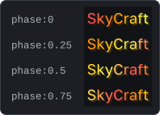

# Gradients

**English** · [Русский](ru/gradients.md) · [← Documentation](README.md)

A gradient fills a [segment](segments.md) with colors that blend smoothly from one to the next,
letter by letter:

```text
[Skyblock Season 3](gradient:#55ffff-#5555ff)
```


## Choosing colors

List two or more colors separated by `-`. Each one is a hex code such as `#ff5555` or a one-letter
[color code](colors.md#the-16-colors) without `&`:

```text
[&lRAINBOW SALE](gradient:#ff5555-#ffff55-#55ff55-#55ffff-#5555ff-#ff55ff)
[Royal Mage](gradient:6-e)
```


Color names such as `red` don't work here. If the list isn't valid, the text keeps its usual colors.

The gradient replaces any colors inside the segment, but styles stay: `[&lRAINBOW SALE](gradient:…)`
is bold and multicolored.

## With placeholders

The gradient is spread over the final text, so it fits a short name and a long one alike:

```text
&7Top killer: [{player}](gradient:#ff5555-#ffaa00)
```


## A gradient that moves

`phase:` shifts the colors along the text. A whole cycle is `1`, so `phase:0.25` moves them a
quarter of the way, and `phase:1` looks the same as `phase:0`:

```text
[SkyCraft](gradient:#ff5555-#ffaa00-#ffff55, phase:0)
[SkyCraft](gradient:#ff5555-#ffaa00-#ffff55, phase:0.25)
[SkyCraft](gradient:#ff5555-#ffaa00-#ffff55, phase:0.5)
[SkyCraft](gradient:#ff5555-#ffaa00-#ffff55, phase:0.75)
```



Show these one after another — in a boss bar, the tab list or a scoreboard title — and the colors
run along the text:


GikyMessage doesn't animate anything by itself: your plugin re-sends the text with the next phase.
Negative phases move the colors the other way.

## For developers

Here is how to animate the text of a [boss bar](https://docs.papermc.io/adventure/bossbar/): compile
the frames once, then switch between them on a timer.

```java
// 20 frames: the colors make a full round in one second at 20 ticks per second.
List<Text<Void>> frames = IntStream.range(0, 20)
        .mapToObj(i -> Text.of("[&lSkyCraft](gradient:#ff5555-#ffaa00-#ffff55, phase:" + i / 20.0 + ")"))
        .toList();

BossBar bar = BossBar.bossBar(Component.empty(), 1f, BossBar.Color.YELLOW, BossBar.Overlay.PROGRESS);
AtomicInteger frame = new AtomicInteger();
Bukkit.getScheduler().runTaskTimer(plugin,
        () -> bar.name(frames.get(frame.getAndUpdate(i -> (i + 1) % frames.size())).render()), 0L, 1L);
```

A text without placeholders builds its component once, so each `render()` here returns a ready
object.

---

[← Segments](segments.md) · [Documentation](README.md) · [Conditions →](conditions.md)
