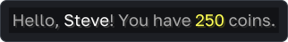
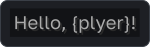

# Placeholders

**English** · [Русский](ru/placeholders.md) · [← Documentation](README.md)

A placeholder is a name in curly braces, like `{player}`. When the plugin sends the message, it puts
the current value in its place:

```text
&7Hello, &f{player}&7! You have &e{coins} &7coins.
```



Which placeholders you can use depends on the plugin that sends the message, and its documentation
should list them. Names are case-sensitive: `{Player}` and `{player}` are two different
placeholders.

## Four things worth knowing

### 1. After a placeholder, your colors come back

Some values arrive with colors of their own, like a rank prefix from a permissions plugin. Those
colors end where the value ends, and the text you wrote after it keeps your formatting:

```text
{prefix} &7{player}&8: &fHi everyone!
```

![A red \[Admin\] prefix, then the gray name and white text](images/en/ph-prefix.svg)

### 2. Values are never read as formatting

Whatever a player types is shown exactly as typed. That's what makes chat formats safe: nobody can
paint their message red or sneak in a button that runs a command.

```text
&7{player}&8: &f{message}
```

' is shown as plain text](images/en/ph-safe.svg)

### 3. A typo stays visible

If the plugin doesn't know a placeholder, it stays in the text unchanged. You'll notice it on the
first try:

```text
&7Hello, {plyer}!
```



### 4. An empty value leaves its spaces behind

When a value is empty, nothing appears in its place, but the spaces around it stay, so
`{clan} {player}` turns into a line that starts with a space. [Conditions](conditions.md) fix this:
they hide a part of the message together with its spaces.

## Placeholders inside actions

Most [segment actions](segments.md) take placeholders too, so a button can depend on who is shown or
who clicks:

```text
&7Online: [&b{player}](suggest:/msg {player} , show:&7Click to message &f{player})
```


These actions fill in placeholders: `run`, `suggest`, `url`, `copy`, `show`, `color`, `style`,
`head`, `lang`, `if` and `unless`. The rest — `insert`, `font`, `sprite`, `gradient`, `phase`,
`transform` and `page` — take fixed text only.

## For developers

When a template is compiled, your factory is asked once for each placeholder name and returns a
handler, or `null` for names it doesn't know. The handler runs on every render and reports the value
for the context it's given:

```java
Text<Player> text = Text.of("&7Hello, &f{player}&7! You have &e{coins} &7coins.", key -> switch (key) {
    case "player" -> (player, value) -> value.text(player.getName());
    case "coins" -> (player, value) -> value.number(economy.balance(player));
    default -> null; // stays as {key}
});

player.sendMessage(text.render(player));
```

A handler reports one value in one of four ways:

| Call | Use it for |
|---|---|
| `value.text("Steve")` | Plain text: names, worlds, anything players can influence |
| `value.number(250)` | Whole numbers such as balances, without turning them into strings first |
| `value.component(component)` | A ready Adventure component, with its own colors and events |
| `value.component(raw, parser)` | A formatted string together with the function that parses it |

Reporting nothing, or `null`, keeps `{key}` in the text. An empty string, `value.text("")`, shows
nothing.

### Formatted values, such as prefixes

Since values are never parsed, `value.text("&cAdmin")` shows the characters `&cAdmin`. If a value is
meant to be formatted — a prefix from your permissions plugin, a nickname from a nickname plugin —
hand over the string together with its parser:

```java
static final Function<String, Component> LEGACY =
        LegacyComponentSerializer.legacyAmpersand()::deserialize;

case "prefix" -> (player, value) -> value.component(prefixOf(player), LEGACY);
```

Keep the parser in a constant, as above. A
[binding](java-api.md#the-same-player-again-and-again-bind) parses the string again only when the
string or the parser changes, and a new lambda on every call would count as a new parser.

---

[← Colors and styles](colors.md) · [Documentation](README.md) · [Segments →](segments.md)
