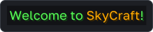
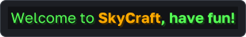
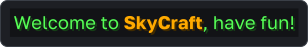
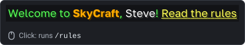
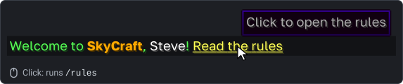

# Quick start: your first message

**English** · [Русский](ru/quick-start.md) · [← Documentation](README.md)

In about five minutes you'll build this welcome message step by step, and pick up most of the format
along the way:


You'll be editing a message in the config of a plugin that uses GikyMessage. Which file and which
key depends on the plugin; here it's a line called `welcome`.

## 1. Color the text

Put `&` and a color code in front of the text. The color stays until the next code:

```text
&aWelcome to &6SkyCraft&a!
```



The codes go from `&0` (black) to `&f` (white); [Colors](colors.md#the-16-colors) shows all sixteen.
For any other color, use a hex code such as `&#ff8800`.

## 2. Make a word bold — and stop it in time

`&l` makes text bold. Bold stays on until a reset, `&r`, and a new color does **not** switch it off.
That's the most common surprise for people used to other plugins:

```text
&aWelcome to &6&lSkyCraft&a, have fun!
```



The rest of the line became bold as well. There's a neat fix: square brackets keep a style inside
them.

```text
&aWelcome to [&6&lSkyCraft], have fun!
```



After the closing bracket the text is green and regular again. Brackets have another job too, as
you'll see in step 4.

## 3. Add the player's name

Now swap "have fun" for the player's name. The plugin fills in placeholders, the names in curly
braces, at the moment it sends the message:

```text
&aWelcome to [&6&lSkyCraft], &f{player}&a!
```


The plugin's documentation lists which placeholders it provides. If you misspell one, it stays in
the text as is, like `{plyer}`, so the mistake is easy to spot.

## 4. Make a clickable link

Square brackets mark a part of the message, and parentheses right after them say what that part does
when someone clicks it:

```text
&aWelcome to [&6&lSkyCraft], &f{player}&a! [&e&nRead the rules](run:/rules)
```



`run:` makes the player run a command. Other actions open a website, copy text, or put a command
into the chat box for the player to finish — they're all in [Segments](segments.md).

## 5. Add a tooltip

Add `show:` after a comma, and a tooltip appears when the mouse is over the link:

```text
&aWelcome to [&6&lSkyCraft], &f{player}&a! [&e&nRead the rules](run:/rules, show:&7Click to open the rules)
```



> [!WARNING]
> A comma inside the parentheses separates actions, so `show:Click here, then read` stops at "Click
> here". If the text needs a comma, put it in quotes: `show:"Click here, then read"`.

## 6. Put it into the config

In YAML, wrap the message in **[single
quotes](https://yaml.org/spec/1.2.2/#732-single-quoted-style)**:

```yaml
welcome: '&aWelcome to [&6&lSkyCraft], &f{player}&a! [&e&nRead the rules](run:/rules, show:&7Click to open the rules)'
```

Single quotes keep the text exactly as written, which matters once you use backslashes, as in `\[`
for a real bracket ([Escaping](escapes.md)). Inside single quotes, write an apostrophe twice:
`'&7Don''t forget to vote!'`.

## You've learned

| You wrote | It means |
|---|---|
| `&a`, `&6` | Change the color |
| `&l` … `&r` | Bold until the reset |
| `[ … ]` | A part of the message with its own style |
| `{player}` | A value the plugin fills in |
| `[text](run:/rules, show:tooltip)` | A part that does something on click and shows a tooltip |

## Where next

- [Cheat sheet](cheatsheet.md) — everything on one page.
- [Recipes](recipes.md) — chat formats, teleport requests, shop messages and more, ready to copy.
- [Conditions](conditions.md) — show a clan tag only to players in a clan.

---

[← Documentation](README.md) · [Colors and styles →](colors.md)
