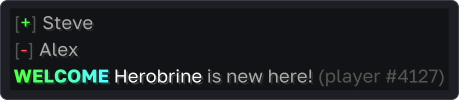
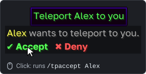
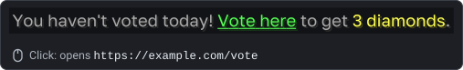
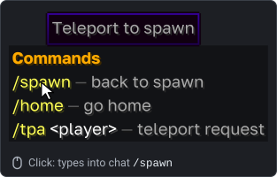
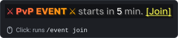
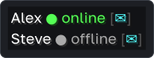

# Recipes

[← Documentation](README.md)

Ready-made messages for common situations. Copy one, change the colors and words, and check which
placeholders your plugin actually provides: the names below are examples.

**Recipes:** [chat format](#chat-format) · [join and quit](#join-and-quit) · [teleport
request](#teleport-request) · [vote reminder](#vote-reminder) · [shop purchase](#shop-purchase) ·
[help menu](#help-menu) · [event announcement](#event-announcement) · [links](#links) · [friend
list](#friend-list)

## Chat format

A clan tag only for players in a clan, a rank prefix, and a name that shows a player card on hover
and starts a private message on click.

```yaml
chat: '[&8\[&6{clan}&8\] ](if:{clan}){prefix}[&f{player}](show:&f{player}\n&7Rank: &f{rank}\n&7Playtime: &f{hours} h\n&eClick to message, suggest:/msg {player} )&8: &f{message}'
```

![\[Knights\] \[Admin\] Steve: message, with a player card tooltip](images/en/rc-chat.svg)

- The clan segment ends with a space inside the brackets, so players without a clan don't get a
  stray space.
- `{message}` is shown exactly as the player typed it, so `&` codes and brackets in it do nothing.
- Placeholders: `clan`, `prefix`, `player`, `rank`, `hours`, `message`.

## Join and quit

```yaml
join: '&8\[&a+&8\] [&7{player}](show:&7First joined: &f{first_join})'
quit: '&8\[&c-&8\] &7{player}'
first-join: '[&lWELCOME](gradient:#55ff55-#55ffff) &f{player} &7is new here! &8(player #{number})'
```



- The brackets around `+` and `-` are escaped: without `\` they would become a segment and
  disappear.
- Placeholders: `player`, `first_join`, `number`.

## Teleport request

Two buttons on their own line, each with a tooltip that explains what it does.

```yaml
tpa-request: '&e{player} &7wants to teleport to you.\n[&a&l✔ Accept](run:/tpaccept {player}, show:&aTeleport {player} to you)   [&c&l✖ Deny](run:/tpdeny {player}, show:&cIgnore the request)'
```



- `\n` moves the buttons to a second line.
- The command gets the name from `{player}`, so clicking accepts exactly this request.

## Vote reminder

```yaml
vote: '&7You haven''t voted today! [&a&nVote here](url:https://example.com/vote, show:&7Opens the voting site) &7to get &e{reward}&7.'
```



- `haven''t`: inside [YAML single quotes](https://yaml.org/spec/1.2.2/#732-single-quoted-style) an
  apostrophe is doubled.
- Placeholder: `reward`.

## Shop purchase

The item name appears in each player's language, and big prices are shortened.

```yaml
bought: '&7You bought &f{amount}× [&b{item}](lang:{item_key}) &7for &e[{price}](transform:compact) &7coins.'
```


- With `{item_key}` = `item.minecraft.diamond_sword`, a player with Russian game language reads
  «Алмазный меч». `{item}` is the backup text.
- Placeholders: `amount`, `item`, `item_key`, `price`.

## Help menu

Commands the player can click to put into the chat box, each with a tooltip.

```yaml
help: '[&6&lCommands]\n[&e/spawn](suggest:/spawn, show:&7Teleport to spawn) &8— &7back to spawn\n[&e/home](suggest:/home, show:&7Teleport to your home) &8— &7go home\n[&e/tpa &f<player>](suggest:/tpa , show:&7Ask a player to teleport) &8— &7teleport request'
```



- `suggest:` doesn't run the command; it types it, so the player can add arguments first.

## Event announcement

```yaml
event: '[&l⚔ PvP EVENT ⚔](gradient:#ff5555-#ffaa00) &7starts in &f{minutes} &7min. [&e&n\[Join\]](run:/event join, show:&7Click to join the event)'
```



- Bold stays inside the gradient segment, so the rest of the line is regular.
- Placeholder: `minutes`.

## Links

```yaml
links: '&7Website: [&b&nexample.com](url:https://example.com)  &7Discord: [&9&ndiscord.gg/example](url:https://discord.gg/example)  &7IP: [&e&nplay.example.com](copy:play.example.com, show:&7Click to copy)'
```


## Friend list

One line per friend: online status from a condition, and a button to message them.

```yaml
friend: '&f{friend} [&a● online|&7● offline](if:{online}==yes) [&8\[&b✉&8\]](suggest:/msg {friend} , show:&7Message {friend})'
```



- `[online|offline](if:…)` picks one of two texts, see [Conditions](conditions.md#otherwise-).
- Placeholders: `friend`, `online` (`yes` or `no`).

---

[← Escaping](escapes.md) · [Documentation](README.md) · [Troubleshooting →](troubleshooting.md)
