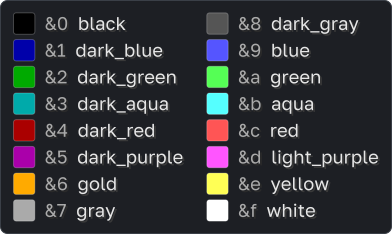

# Шпаргалка

[English](../cheatsheet.md) · **Русский** · [← Документация](README.md)

Весь формат на одной странице. Каждый заголовок ведёт на подробную страницу.

## [Цвета и стили](colors.md)

| Пишете | Результат |
|---|---|
| `&0`…`&9`, `&a`…`&f` | Один из [16 цветов](colors.md#16-цветов) |
| `&#ff8800`, `#ff8800` | Любой цвет (HEX), всегда шесть цифр |
| `&l` `&o` `&n` `&m` `&k` | Жирный, курсив, подчёркнутый, зачёркнутый, скрытый |
| `&r` | Сброс к обычному тексту |
| `$#000000`, `$#000000:80`, `$#000000:00` | Цвет тени, с прозрачностью, без тени *(1.21.4+)* |

Код цвета заканчивает стили и тень, поэтому сначала пишите цвет: `&6&l` — жирный золотой,
`&f$#ff5555` — белый с красной тенью. `&r` сбрасывает к обычному тексту, а скобки держат стиль
внутри себя: `&a[&lЗаголовок] остальное`.

`#` или `$` и шесть шестнадцатеричных цифр — всегда код. Чтобы показать такой текст, например номер
заявки или цену, поставьте перед ним обратный слэш: `\#123456`, `\$100000`.



## [Плейсхолдеры](placeholders.md)

| Пишете | Результат |
|---|---|
| `{player}` | Значение от плагина; незнакомые имена остаются как `{player}` |

Значения показываются ровно такими, какие они есть: `&c` внутри значения — не цвет.

## [Сегменты](segments.md)

`[текст](действие:значение, действие:значение)` — действия получает `текст`; его стиль остаётся
внутри скобок.

| Действие | Что делает |
|---|---|
| `run:/spawn` | Выполняет команду по клику |
| `suggest:/msg Steve ` | Вставляет текст в строку чата по клику |
| `url:https://example.com` | Открывает ссылку по клику |
| `copy:play.example.com` | Копирует текст по клику |
| `page:2` | Листает книгу по клику |
| `show:&7Подсказка\nВторая строка` | Подсказка при наведении |
| `insert:текст` | Вставляет текст по Shift+клику |
| `head:{player}` | Голова игрока *(1.21.9+)* |
| `sprite:myserver:icons/coin` | Текстура *(1.21.9+)* |
| `font:uniform` | Другой шрифт |
| `color:red`, `style:"gold bold $#000000"`, `shadow:#000000:80` | Цвет, стиль и тень там, где текст сегмента их не задал |
| `force-color:red`, `force-style:"gold bold"`, `force-shadow:none` | То же поверх всего внутри сегмента |
| `gradient:#ff5555-#5555ff`, `phase:0.5` | [Градиент](gradients.md), сдвинутый вдоль текста |
| `if:{clan}`, `unless:{clan}`, `if:{group}==vip`, `if:{level}>=10` | [Условия](conditions.md) |
| `lang:item.minecraft.diamond` | [Перевод](translations.md) на язык игрока |
| `transform:compact`, `transform:"upper max:10"` | [Преобразования](transforms.md) |

- Действия разделяются запятыми; значения с запятой или `)` — в кавычках:
  `show:"Нажмите, чтобы открыть"`.
- Внутри кавычек кавычка пишется как `\"`; `\n` и остальное работают как везде.
- Одно действие по клику на сегмент. Незнакомые действия пропускаются.

## [Условия](conditions.md)

| Пишете | Показывается |
|---|---|
| `[{clan} ](if:{clan})` | Пока в `{clan}` есть текст |
| `[без клана](unless:{clan})` | Пока `{clan}` пустой |
| `[VIP](if:{group}==vip)`, `(if:{group}!=vip)` | Когда значения равны / различаются |
| `[Про](if:{level}>=10)`, а также `>` `<` `<=` | Когда число не меньше 10 |
| `(if:{a} && {b})`, `(if:{a} \|\| {b})` | Когда выполнены оба / хотя бы одно |
| `[Да\|Нет](if:{x})` | Первая ветка при выполненном условии, иначе вторая |
| `[A\|B\|C](if:{x}==1, if:{x}==2)` | A, B или запасная C |

Пробелы держите внутри скрываемого сегмента: `[{clan} ](if:{clan}){player}`.

## [Преобразования](transforms.md)

`compact` (1234567 → 1.2M) · `upper` · `lower` · `smallcaps` (ꜱᴛᴇᴠᴇ, только латиница) · `max:N`

## [Экранирование](escapes.md)

| Пишете | Получаете |
|---|---|
| `\[` `\]` `\{` `\}` `\\` | `[` `]` `{` `}` `\` |
| `\n` | Перенос строки |
| `\\|` | `\|` внутри сегмента с условием |
| `\&` `\#` `\$` | `&` `#` `$` там, где с них начался бы код: `R\&D`, `\$100000` |

## YAML

```yaml
message: '&8\[&6VIP&8\] &7Не забудь проголосовать!'   # одинарные кавычки; апостроф пишется как ''
```

[Одинарные кавычки](https://yaml.org/spec/1.2.2/#732-single-quoted-style) оставляют обратные слэши
как есть.
