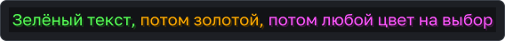
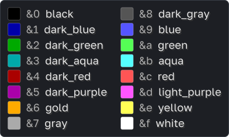
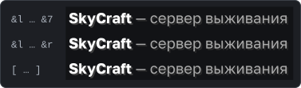
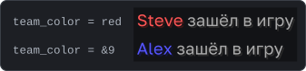

# Цвета и стили

[English](../colors.md) · **Русский** · [← Документация](README.md)

Поставьте перед текстом `&` и код. **Цвет** держится до следующего цвета, а **стиль**, например
жирный, — до `&r`.

```text
&aЗелёный текст, &6потом золотой, &#ff55ffпотом любой цвет на выбор
```



**На странице:** [16 цветов](#16-цветов) · [HEX-цвета](#любой-цвет-hex-коды) · [стили](#стили) ·
[как выключить стиль](#как-выключить-стиль) · [тень текста](#тень-текста) · [цвет через
действие](#цвет-для-одной-части-color-и-style)

## 16 цветов



| Код | Название | Код | Название |
|---|---|---|---|
| `&0` | `black` — чёрный | `&8` | `dark_gray` — тёмно-серый |
| `&1` | `dark_blue` — тёмно-синий | `&9` | `blue` — синий |
| `&2` | `dark_green` — тёмно-зелёный | `&a` | `green` — зелёный |
| `&3` | `dark_aqua` — тёмно-бирюзовый | `&b` | `aqua` — бирюзовый |
| `&4` | `dark_red` — тёмно-красный | `&c` | `red` — красный |
| `&5` | `dark_purple` — фиолетовый | `&d` | `light_purple` — розовый |
| `&6` | `gold` — золотой | `&e` | `yellow` — жёлтый |
| `&7` | `gray` — серый | `&f` | `white` — белый |

Английские названия пригодятся для [действия `color`](#цвет-для-одной-части-color-и-style). Коды
работают и заглавными буквами: `&A` — то же, что `&a`.

## Любой цвет: HEX-коды

`&#` и шесть шестнадцатеричных цифр дают любой цвет. `&` можно не писать: `#ff8800` — тот же код.

```text
&#ff8800Оранжевый &#00aaffголубой #ff66ccрозовый
```


В коде всегда ровно шесть цифр, поэтому текст после него может начинаться с любого символа:
`&#ff8800Bad` — это слово «Bad» оранжевым. Коды короче, например `&#f80`, кодами не считаются и
остаются текстом.

`#` и шесть цифр или латинских букв от `a` до `f` — это цвет, даже если вы имели в виду обычный
текст, например номер заявки. Чтобы показать такой текст, поставьте перед ним обратный слэш:
`\#123456`.

## Стили

| Код | Стиль |
|---|---|
| `&l` | **Жирный** |
| `&o` | *Курсив* |
| `&n` | Подчёркнутый |
| `&m` | ~~Зачёркнутый~~ |
| `&k` | Скрытый: случайные символы, которые всё время меняются |
| `&r` | Сброс: снова обычный текст, без цвета и стиля |

```text
&lЖирный&r &oКурсив&r &nПодчёркнутый&r &mЗачёркнутый&r &kСкрытый
```


Стили складываются: `&l&n` — жирный и подчёркнутый. Порядок кодов не важен, поэтому `&l&c` и `&c&l`
одинаково дают жирный красный.

## Как выключить стиль

Новый цвет не выключает ни жирный, ни курсив, ни другие стили. [Классические
`§`-коды](https://minecraft.wiki/w/Formatting_codes#Java_Edition) и многие плагины, которые их
повторяют, ведут себя иначе, так что это стоит запомнить. Закончить стиль можно кодом `&r` или
удержать его внутри квадратных скобок:

```text
&f&lSkyCraft &7— сервер выживания
&f&lSkyCraft&r &7— сервер выживания
[&f&lSkyCraft] &7— сервер выживания
```



В первой строке после `&l` жирное всё, включая серую часть. Вторая строка сбрасывает стиль после
названия. Третья держит стиль внутри скобок — так часто короче: после `]` текст продолжается тем
цветом и стилем, какие были до `[`.

## Тень текста

Minecraft рисует под текстом его тёмную копию — тень. `$#` и шесть шестнадцатеричных цифр задают её
цвет. `#` здесь можно не писать: `$ff5555` — тот же код.

```text
$#ff5555&fКрасная тень   $#5555ff:80&fПолупрозрачная синяя   $#000000:00&fБез тени
```


| Пишете | Тень |
|---|---|
| `$#RRGGBB`, `$RRGGBB` | Полностью видимая, этого цвета |
| `$#RRGGBB:AA` | Две цифры после двоеточия — прозрачность: `00` — не видна, `80` — наполовину, `ff` — полностью |
| `$#000000:00` | Тени нет совсем |

`$` и шесть цифр — это тень, даже если вы имели в виду цену. Чтобы показать такой текст, поставьте
перед ним обратный слэш: `\$100000`.

> [!NOTE]
> [Свою тень](https://minecraft.wiki/w/Text_component_format#Java_Edition) игроки видят в Minecraft
> 1.21.4 и новее; у старых клиентов обычная тень. Серверу нужен Adventure 4.18 или новее, иначе
> сообщение не загрузится — ошибка скажет об этом.

## Цвет для одной части: `color` и `style`

[Сегменты](segments.md) умеют задавать цвет и стиль своего текста через действие. Это то же самое,
что `&`-коды, но значение может прийти из плейсхолдера — например, цвет команды:

```text
[{player}](color:{team_color}) &7зашёл в игру
```



`color:` принимает один цвет в любой форме: `red`, `c`, `&c`, `#ff5555` или `&#ff5555`. `style:`
принимает несколько значений через пробел: цвета, слова `bold`, `italic`, `underlined`,
`strikethrough`, `obfuscated` и `reset`, `&`-коды или [тень](#тень-текста), например `$#000000:80`:

```text
[Ивент уже начался!](style:"gold bold")
[Ивент уже начался!](style:&6&l)
[Ивент уже начался!](style:"gold $#000000:80")
```

`shadow:` задаёт только тень, поэтому его плейсхолдеру не нужен `$`. Он принимает тень так же, как
в тексте, со знаками `$` и `#` или без них, например `#ff5555` или `$#ff5555:80`, а `none` убирает
тень:

```text
[{player}](shadow:{team_shadow})
[Ивент уже начался!](shadow:#000000:80)
```

`reset` в `style:` сбрасывает и тень. Если сервер не поддерживает цвет тени, тень из плейсхолдера
пропускается, а остальной стиль применяется.

Если значение не подходит — например, плейсхолдер пустой, — текст сохраняет те цвета, что у него
были. Если у сегмента несколько таких действий, цвет из `color` важнее цвета из `style`, а тень из
`shadow` — тени из `style`.

## Для разработчиков

Плейсхолдер с цветом передаётся как текст в любой из форм выше:

```java
case "team_color" -> (player, value) -> value.text(teamOf(player).colorCode()); // "&c", "red", "#ff5555"…
```

---

[← Быстрый старт](quick-start.md) · [Документация](README.md) · [Плейсхолдеры →](placeholders.md)
