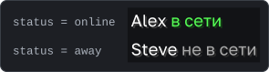
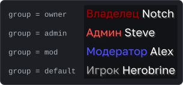
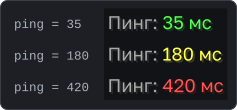

# Условия

[English](../conditions.md) · **Русский** · [← Документация](README.md)

Условия показывают [сегмент](segments.md) только в нужных случаях: тег клана — только тем, кто в
клане, значок VIP — только VIP-игрокам, «в сети» или «не в сети» — в зависимости от статуса.

```text
[&8\[&6{clan}&8\] ](if:{clan})&f{player}
```

![У игрока с кланом перед ником виден тег \[Рыцари\], у игрока без клана — только
ник](../images/ru/cond-intro.svg)

## Показать или скрыть: `if` и `unless`

`if:{значение}` показывает сегмент, пока в значении есть текст. `unless:{значение}` делает
наоборот — показывает, пока значение пустое:

```text
[&8\[&6{clan}&8\] ](if:{clan})&f{player}
&f{player}[ &7(без клана)](unless:{clan})
```

| `{clan}` | Первая строка | Вторая строка |
|---|---|---|
| `Рыцари` | `[Рыцари] Steve` | `Steve` |
| *(пусто)* | `Steve` | `Steve (без клана)` |

Значение из одних пробелов считается пустым. Скрытый сегмент не оставляет после себя ничего, поэтому
пробелы, которые к нему относятся, держите **внутри** скобок, как в `[… ](if:…)` выше. Иначе при
пустом клане перед ником останется лишний пробел.

## Сравнение: `==` и `!=`

Условие может сравнить два значения или значение с постоянным текстом:

```text
[&6\[VIP\] ](if:{group}==vip)&f{player}
[&7(отошёл) ](if:{status}!=online)&f{player}
```

![Значок \[VIP\] только у группы vip и пометка (отошёл) у игрока со статусом не
online](../images/ru/cond-compare.svg)

Пробелы вокруг значений не важны. Регистр важен: `VIP` и `vip` — разные значения. Два числа
сравниваются по величине, так что `10.0` равно `10`.

## Иначе: `|`

Внутри сегмента с условием `|` делит текст на ветки. Первая ветка показывается, когда условие
выполнено, вторая — когда нет:

```text
&f{friend} [&aв сети|&7не в сети](if:{status}==online)
```



Несколько условий выбирают из нескольких веток по порядку: первое условие отвечает за первую ветку,
второе — за вторую, а последняя ветка показывается, когда не выполнено ни одно:

```text
[&4Владелец|&cАдмин|&9Модератор|&7Игрок](if:{group}==owner, if:{group}==admin, if:{group}==mod) &f{player}
```



Остальные действия сегмента применяются к той ветке, которая показана, так что
`[A|B](if:{x}, run:/cmd)` выполнит `/cmd` в обоих случаях.

## Числа: `<`, `>`, `<=`, `>=`

Эти операторы сравнивают числа, так что сообщение может зависеть от пинга, уровня или баланса:

```text
&7Пинг: [&a{ping} мс|&e{ping} мс|&c{ping} мс](if:{ping}<100, if:{ping}<250)
```



У числа могут быть минус и десятичная точка: `-5`, `2.5`. Если одна из сторон не число — например,
пустое значение или `1,000`, — сравнение не выполняется.

## Несколько условий вместе: `&&` и `||`

`&&` значит «и», `||` — «или»:

```text
[&6\[VIP\] ](if:{group}==vip || {group}==mvp)&f{player}
[&a\[Забрать\]](if:{level}>=10 && {claimed}!=yes, run:/reward claim)
```

`&&` связывает сильнее, поэтому `{a} || {b} && {c}` означает «a или одновременно b и c». Скобок нет;
для более сложной логики вложите сегмент в сегмент.

`unless` переворачивает всё условие, а `if` и `unless` в одном сегменте должны выполниться оба:

| Нужно | Пишите |
|---|---|
| A **и** B | `if:{a} && {b}` |
| A **или** B | `if:{a} \|\| {b}` |
| **Не** A | `unless:{a}` |
| A **и не** B | `if:{a}, unless:{b}` |
| **Ни** A, **ни** B | `unless:{a} \|\| {b}` |

Например, значок VIP, который исчезает, пока игрок в ванише:

```text
[&6\[VIP\] ](if:{vip}, unless:{vanished})&f{player}
```

Без веток сегмент учитывает только **последний** `if` и последний `unless`, поэтому
`[…](if:{a}, if:{b})` проверяет лишь `{b}`. Вместо этого соедините их через `&&`.

## Правила записи

- В сегменте без условия `|` — обычный текст. В сегменте с условием пишите `\|`, если `|` не должен
  его делить.
- Условие без плейсхолдеров решается при загрузке сообщения: `[x](if:yes)` показывается всегда, а
  `[x](if:a==b)` — никогда.
- Плейсхолдер, которого плагин не знает, остаётся `{имя}`, а это текст, так что `if:{неизвестный}`
  выполняется всегда.
- Операторы берутся из сообщения, а не из значений: значение вроде `x || y` — просто текст.
- Равенство пишется двумя знаками: `==`. Одиночный `=` — обычный текст, поэтому `if:{group}=vip`
  ничего не сравнивает и выполняется всегда.

## Для разработчиков

Условия смотрят на переданные значения:

- пустой текст, одни пробелы и компоненты, в которых только оформление, считаются пустыми;
- числа всегда считаются текстом, включая `0`;
- отсутствующее значение превращается в `{key}` и поэтому считается текстом;
- сравнение берёт обычный текст обеих сторон, так что компонент `Component.text("5")` равен числу
  `5`;
- `<`, `>`, `<=` и `>=` работают с числами, переданными любым способом: `value.number(42)`,
  `value.text("2.5")` или компонентом.

---

[← Градиенты](gradients.md) · [Документация](README.md) · [Переводы →](translations.md)
