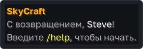

# Экранирование и кавычки

[English](../escapes.md) · **Русский** · [← Документация](README.md)

У нескольких символов в формате есть работа: `[` и `]` создают [сегменты](segments.md), `{` и `}` —
[плейсхолдеры](placeholders.md). Чтобы показать их как обычный текст, поставьте перед ними обратный
слэш:

```text
&8\[&6VIP&8\] &f{player}&7: &fВсем привет!
```

![\[VIP\] Steve: Всем привет! с видимыми квадратными скобками](../images/ru/esc-brackets.svg)

| Пишете | Получаете |
|---|---|
| `\[` и `\]` | `[` и `]` |
| `\{` и `\}` | `{` и `}` |
| `\\|` | `\|` внутри сегмента с [условием](conditions.md#иначе-), где просто `\|` разделил бы его |
| `\\` | `\` |
| `\&`, `\#` и `\$` | `&`, `#` и `$` там, где с них начался бы [код цвета или тени](colors.md) |
| `\n` | Перенос строки |

## Переносы строк

`\n` начинает новую строку — удобно для многострочных объявлений и подсказок:

```text
&6&lSkyCraft&r\n&7С возвращением, &f{player}&7!\n&7Введите &e/help&7, чтобы начать.
```



## Что будет без обратного слэша

- `[` всегда начинает сегмент, даже в смайлике: `:-[` потеряет скобку, потому что откроет сегмент,
  который так и не закроется. Пишите `:-\[`.
- `]` без открытой `[` — обычный текст, как и `{` без парной `}`.
- `&`, `#` и `$`, после которых нет кода, остаются как есть: `Tom & Jerry`, `#1`, `$5`.
- Там, где с них начинается код, нужен обратный слэш: в `R&D` пропадёт `&D` — это код цвета, а
  `$100000` прочитается как тень. Пишите `R\&D` и `\$100000`.

## Кавычки внутри действий

Значения действий с запятыми берутся в кавычки, `"…"` или `'…'`. В русском тексте это нужно часто —
запятая перед «чтобы», «если», «который» встречается постоянно. Например:

```text
[&e\[?\]](show:"&6Правила\n&71. Будьте вежливы, не спамьте\n&72. Никаких читов")
```

Внутри кавычек `\n`, `\[` и другие экранирования работают так же, как без них, а пробелы по краям
сохраняются. Обратный слэш нужен только перед кавычкой: `\"` или `\'`.

## YAML: одинарные кавычки

Большинство плагинов хранят сообщения в YAML-файлах, а у YAML свои правила кавычек. [Одинарные
кавычки](https://yaml.org/spec/1.2.2/#732-single-quoted-style) сохраняют всё как написано, и
сообщение доходит до GikyMessage без изменений:

```yaml
vip-chat: '&8\[&6VIP&8\] &f{player}&7: &f{message}'
```

В **двойных** кавычках YAML сам [обрабатывает обратные
слэши](https://yaml.org/spec/1.2.2/#57-escaped-characters), и из-за `\[` весь файл не загрузится с
ошибкой о неизвестной escape-последовательности. Если без двойных кавычек никак, удваивайте каждый
обратный слэш: `"&8\\[&6VIP&8\\]"`.

Апостроф внутри одинарных кавычек пишется дважды — пригодится, если на сервере есть английские
сообщения:

```yaml
vote: '&7Don''t forget to vote today!'
```

---

[← Преобразования](transforms.md) · [Документация](README.md) · [Рецепты →](recipes.md)
