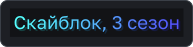
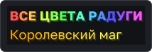
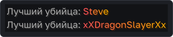
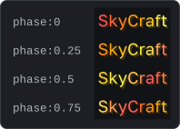

# Градиенты

[English](../gradients.md) · **Русский** · [← Документация](README.md)

Градиент заливает [сегмент](segments.md) цветами, которые плавно перетекают друг в друга, буква за
буквой:

```text
[Скайблок, 3 сезон](gradient:#55ffff-#5555ff)
```



## Выбор цветов

Перечислите два цвета или больше через `-`. Каждый цвет — это HEX-код вроде `#ff5555` или
однобуквенный [код цвета](colors.md#16-цветов) без `&`:

```text
[&lВСЕ ЦВЕТА РАДУГИ](gradient:#ff5555-#ffff55-#55ff55-#55ffff-#5555ff-#ff55ff)
[Королевский маг](gradient:6-e)
```



Названия цветов вроде `red` здесь не работают. Если список неверный, текст остаётся в своих обычных
цветах.

Градиент заменяет цвета внутри сегмента, но стили сохраняются: `[&lВСЕ ЦВЕТА РАДУГИ](gradient:…)`
получается жирным и разноцветным.

## С плейсхолдерами

Градиент растягивается на итоговый текст, поэтому одинаково ложится и на короткий ник, и на длинный:

```text
&7Лучший убийца: [{player}](gradient:#ff5555-#ffaa00)
```



## Бегущий градиент

`phase:` сдвигает цвета вдоль текста. Полный круг — это `1`, так что `phase:0.25` сдвигает их на
четверть, а `phase:1` выглядит так же, как `phase:0`:

```text
[SkyCraft](gradient:#ff5555-#ffaa00-#ffff55, phase:0)
[SkyCraft](gradient:#ff5555-#ffaa00-#ffff55, phase:0.25)
[SkyCraft](gradient:#ff5555-#ffaa00-#ffff55, phase:0.5)
[SkyCraft](gradient:#ff5555-#ffaa00-#ffff55, phase:0.75)
```



Показывайте эти строки одну за другой — в боссбаре, табе или заголовке скорборда, — и цвета побегут
по тексту:


Сам GikyMessage ничего не анимирует: ваш плагин заново отправляет текст со следующей фазой.
Отрицательные фазы двигают цвета в обратную сторону.

## Для разработчиков

Вот как анимировать текст [боссбара](https://docs.papermc.io/adventure/bossbar/): скомпилируйте
кадры один раз и переключайте их по таймеру.

```java
// 20 кадров: при 20 тиках в секунду цвета делают полный круг за секунду.
List<Text<Void>> frames = IntStream.range(0, 20)
        .mapToObj(i -> Text.of("[&lSkyCraft](gradient:#ff5555-#ffaa00-#ffff55, phase:" + i / 20.0 + ")"))
        .toList();

BossBar bar = BossBar.bossBar(Component.empty(), 1f, BossBar.Color.YELLOW, BossBar.Overlay.PROGRESS);
AtomicInteger frame = new AtomicInteger();
Bukkit.getScheduler().runTaskTimer(plugin,
        () -> bar.name(frames.get(frame.getAndUpdate(i -> (i + 1) % frames.size())).render()), 0L, 1L);
```

Текст без плейсхолдеров собирает компонент один раз, поэтому каждый `render()` здесь возвращает
готовый объект.

---

[← Сегменты](segments.md) · [Документация](README.md) · [Условия →](conditions.md)
