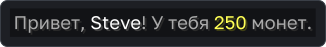
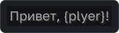

# Плейсхолдеры

[English](../placeholders.md) · **Русский** · [← Документация](README.md)

Плейсхолдер — это имя в фигурных скобках, например `{player}`. Когда плагин отправляет сообщение, он
подставляет на это место текущее значение:

```text
&7Привет, &f{player}&7! У тебя &e{coins} &7монет.
```



Какие плейсхолдеры доступны, зависит от плагина, который отправляет сообщение; список должен быть в
его документации. Регистр важен: `{Player}` и `{player}` — два разных плейсхолдера.

## Четыре вещи, которые стоит знать

### 1. После плейсхолдера возвращаются ваши цвета

Некоторые значения приходят со своими цветами — например, префикс ранга из плагина прав. Эти цвета
заканчиваются там же, где значение, а текст, который вы написали после него, остаётся в вашем
оформлении:

```text
{prefix} &7{player}&8: &fВсем привет!
```

![Красный префикс \[Админ\], затем серый ник и белый текст](../images/ru/ph-prefix.svg)

### 2. Значения никогда не читаются как форматирование

Что бы игрок ни написал, оно показывается ровно так, как написано. Поэтому формат чата безопасен:
никто не сможет покрасить своё сообщение или подсунуть кнопку, которая выполняет команду.

```text
&7{player}&8: &f{message}
```

» показано как обычный текст](../images/ru/ph-safe.svg)

### 3. Опечатку видно сразу

Если плагин не знает плейсхолдер, тот остаётся в тексте без изменений. Вы заметите это с первой же
попытки:

```text
&7Привет, {plyer}!
```



### 4. Пустое значение оставляет пробелы

Если значение пустое, на его месте ничего не появится, но пробелы вокруг останутся: из
`{clan} {player}` получится строка, которая начинается с пробела. Это решают
[условия](conditions.md): они прячут часть сообщения вместе с её пробелами.

## Плейсхолдеры внутри действий

Большинство [действий сегмента](segments.md) тоже принимают плейсхолдеры, так что кнопка может
зависеть от того, кого показывают или кто кликает:

```text
&7В сети: [&b{player}](suggest:/msg {player} , show:&7Написать игроку &f{player})
```


Плейсхолдеры подставляются в действиях `run`, `suggest`, `url`, `copy`, `show`, `color`, `style`,
`head`, `lang`, `if` и `unless`. Остальные — `insert`, `font`, `sprite`, `gradient`, `phase`,
`transform` и `page` — принимают только неизменный текст.

## Для разработчиков

При компиляции шаблона ваша фабрика один раз получает имя каждого плейсхолдера и возвращает для него
обработчик или `null`, если имя ей незнакомо. Обработчик вызывается при каждом рендере и сообщает
значение для переданного контекста:

```java
Text<Player> text = Text.of("&7Привет, &f{player}&7! У тебя &e{coins} &7монет.", key -> switch (key) {
    case "player" -> (player, value) -> value.text(player.getName());
    case "coins" -> (player, value) -> value.number(economy.balance(player));
    default -> null; // останется {key}
});

player.sendMessage(text.render(player));
```

Обработчик сообщает одно значение одним из четырёх способов:

| Вызов | Для чего |
|---|---|
| `value.text("Steve")` | Обычный текст: ники, миры, всё, на что могут влиять игроки |
| `value.number(250)` | Целые числа, например баланс, — без предварительного превращения в строку |
| `value.component(component)` | Готовый компонент Adventure со своими цветами и событиями |
| `value.component(raw, parser)` | Отформатированная строка вместе с функцией, которая её разбирает |

Если ничего не передать или передать `null`, в тексте останется `{key}`. Пустая строка,
`value.text("")`, не покажет ничего.

### Отформатированные значения, например префиксы

Значения никогда не разбираются, поэтому `value.text("&cАдмин")` покажет символы `&cАдмин`. Если
значение должно быть с оформлением — префикс из плагина прав, ник из плагина ников, — передайте
строку вместе с парсером:

```java
static final Function<String, Component> LEGACY =
        LegacyComponentSerializer.legacyAmpersand()::deserialize;

case "prefix" -> (player, value) -> value.component(prefixOf(player), LEGACY);
```

Храните парсер в константе, как выше. [Привязка](java-api.md#один-и-тот-же-игрок-снова-и-снова-bind)
разбирает строку заново, только когда меняется строка или парсер, а новая лямбда на каждый вызов
считается новым парсером.

---

[← Цвета и стили](colors.md) · [Документация](README.md) · [Сегменты →](segments.md)
