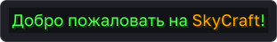
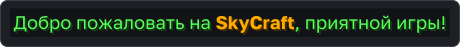
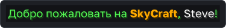
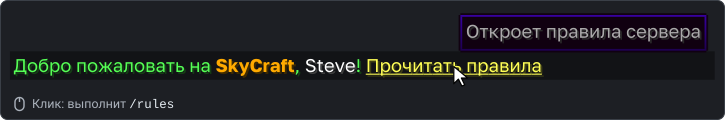

# Быстрый старт: первое сообщение

[English](../quick-start.md) · **Русский** · [← Документация](README.md)

Минут за пять вы шаг за шагом соберёте вот такое приветствие и по пути разберётесь в большей части
формата:


Править вы будете сообщение в конфиге плагина, который использует GikyMessage. Какой это файл и
какой ключ, зависит от плагина; здесь это строка `welcome`.

## 1. Покрасьте текст

Поставьте перед текстом `&` и код цвета. Цвет держится до следующего кода:

```text
&aДобро пожаловать на &6SkyCraft&a!
```



Коды идут от `&0` (чёрный) до `&f` (белый) — все шестнадцать есть в разделе
[Цвета](colors.md#16-цветов). Для любого другого цвета есть HEX-код вроде `&#ff8800`.

## 2. Сделайте слово жирным — и вовремя остановитесь

`&l` делает текст жирным. Ставьте его после цвета: новый цвет заканчивает жирный, поэтому зелёный
текст после названия снова обычный:

```text
&aДобро пожаловать на &6&lSkyCraft&a, приятной игры!
```



Сначала цвет, потом стиль — `&6&l`: в `&l&6` цвет сразу закончил бы жирный. То же самое делают
квадратные скобки, и они удобны, когда у остатка строки нет своего кода цвета: стиль, написанный
внутри скобок, остаётся внутри них.

```text
&aДобро пожаловать на [&6&lSkyCraft], приятной игры!
```

После закрывающей скобки текст снова зелёный и обычный. У скобок есть и вторая работа — о ней в
шаге 4.

## 3. Добавьте ник игрока

Теперь замените «приятной игры» на ник игрока. Плагин подставляет плейсхолдеры — имена в фигурных
скобках — в момент отправки сообщения:

```text
&aДобро пожаловать на [&6&lSkyCraft], &f{player}&a!
```



Какие плейсхолдеры есть, написано в документации плагина. Если ошибиться в имени, оно так и
останется в тексте, например `{plyer}`, — ошибку сразу видно.

## 4. Сделайте ссылку, по которой можно кликнуть

Квадратные скобки выделяют часть сообщения, а круглые скобки сразу после них говорят, что эта часть
делает при клике:

```text
&aДобро пожаловать на [&6&lSkyCraft], &f{player}&a! [&e&nПрочитать правила](run:/rules)
```


`run:` заставляет игрока выполнить команду. Другие действия открывают сайт, копируют текст или
вставляют команду в строку чата, чтобы игрок её дописал, — все они в разделе
[Сегменты](segments.md).

## 5. Добавьте подсказку

Допишите через запятую `show:` — и при наведении мыши на ссылку появится подсказка:

```text
&aДобро пожаловать на [&6&lSkyCraft], &f{player}&a! [&e&nПрочитать правила](run:/rules, show:&7Откроет правила сервера)
```



> [!WARNING]
> Запятая внутри круглых скобок разделяет действия. Подсказка `show:Нажмите, чтобы открыть`
> оборвётся на «Нажмите». Если в тексте нужна запятая, возьмите его в кавычки:
> `show:"Нажмите, чтобы открыть"`.

## 6. Положите сообщение в конфиг

В YAML заключайте сообщение в **[одинарные
кавычки](https://yaml.org/spec/1.2.2/#732-single-quoted-style)**:

```yaml
welcome: '&aДобро пожаловать на [&6&lSkyCraft], &f{player}&a! [&e&nПрочитать правила](run:/rules, show:&7Откроет правила сервера)'
```

Одинарные кавычки сохраняют текст ровно таким, как он написан. Это важно, как только появляются
обратные слэши, например `\[` для настоящей скобки ([Экранирование](escapes.md)). Апостроф внутри
одинарных кавычек пишется дважды: `'&7It''s OK'`.

## Что вы узнали

| Вы написали | Это значит |
|---|---|
| `&a`, `&6` | Сменить цвет |
| `&l` … `&r` | Жирный до сброса |
| `[ … ]` | Часть сообщения со своим стилем |
| `{player}` | Значение, которое подставит плагин |
| `[текст](run:/rules, show:подсказка)` | Часть, которая что-то делает при клике и показывает подсказку |

## Что дальше

- [Шпаргалка](cheatsheet.md) — всё на одной странице.
- [Рецепты](recipes.md) — формат чата, запросы на телепортацию, сообщения магазина и другое, готовое
  к копированию.
- [Условия](conditions.md) — как показывать тег клана только тем, кто в клане.

---

[← Документация](README.md) · [Цвета и стили →](colors.md)
