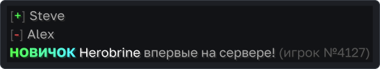
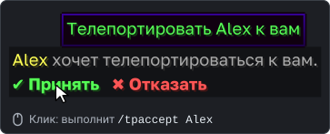
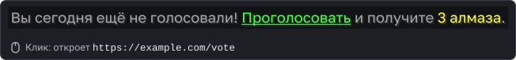
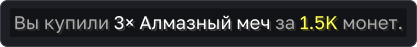
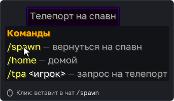
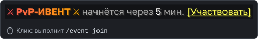

# Рецепты

[English](../recipes.md) · **Русский** · [← Документация](README.md)

Готовые сообщения для частых ситуаций. Скопируйте нужное, поменяйте цвета и слова и проверьте, какие
плейсхолдеры на самом деле даёт ваш плагин: имена ниже — только пример.

**Рецепты:** [формат чата](#формат-чата) · [вход и выход](#вход-и-выход) · [запрос на
телепорт](#запрос-на-телепорт) · [голосование](#напоминание-о-голосовании) · [покупка в
магазине](#покупка-в-магазине) · [меню помощи](#меню-помощи) · [объявление
ивента](#объявление-ивента) · [ссылки](#ссылки) · [список друзей](#список-друзей)

## Формат чата

Тег клана только у игроков в клане, префикс ранга и ник, который при наведении показывает карточку
игрока, а по клику начинает личное сообщение.

```yaml
chat: '[&8\[&6{clan}&8\] ](if:{clan}){prefix}[&f{player}](show:&f{player}\n&7Ранг: &f{rank}\n&7Наиграно: &f{hours} ч\n&eНажмите и напишите игроку, suggest:/msg {player} )&8: &f{message}'
```

![\[Рыцари\] \[Админ\] Steve: сообщение, с карточкой игрока в подсказке](../images/ru/rc-chat.svg)

- Сегмент клана заканчивается пробелом внутри скобок, поэтому у игроков без клана не появляется
  лишний пробел.
- `{message}` показывается ровно так, как его набрал игрок, так что `&`-коды и скобки в нём ничего
  не делают.
- Плейсхолдеры: `clan`, `prefix`, `player`, `rank`, `hours`, `message`.

## Вход и выход

```yaml
join: '&8\[&a+&8\] [&7{player}](show:&7Впервые зашёл: &f{first_join})'
quit: '&8\[&c-&8\] &7{player}'
first-join: '[&lНОВИЧОК](color:#55ff55-#55ffff) &f{player} &7впервые на сервере! &8(игрок №{number})'
```



- Скобки вокруг `+` и `-` экранированы: без `\` они стали бы сегментом и пропали бы.
- Плейсхолдеры: `player`, `first_join`, `number`.

## Запрос на телепорт

Две кнопки на отдельной строке, у каждой — подсказка о том, что она делает.

```yaml
tpa-request: '&e{player} &7хочет телепортироваться к вам.\n[&a&l✔ Принять](run:/tpaccept {player}, show:&aТелепортировать {player} к вам)   [&c&l✖ Отказать](run:/tpdeny {player}, show:&cОтклонить запрос)'
```



- `\n` переносит кнопки на вторую строку.
- Команда получает ник из `{player}`, поэтому клик принимает именно этот запрос.

## Напоминание о голосовании

```yaml
vote: '&7Вы сегодня ещё не голосовали! [&a&nПроголосовать](url:https://example.com/vote, show:&7Откроет сайт голосования) &7и получите &e{reward}&7.'
```



- В подсказке нет запятых, поэтому кавычки не нужны. Если запятая понадобится, возьмите текст
  подсказки в кавычки.
- Плейсхолдер: `reward`.

## Покупка в магазине

Название предмета — на языке каждого игрока, а большие цены сокращаются.

```yaml
bought: '&7Вы купили &f{amount}× [&b{item}](lang:{item_key}) &7за &e[{price}](transform:compact) &7монет.'
```



- При `{item_key}` = `item.minecraft.diamond_sword` игрок с английским языком игры прочитает
  «Diamond Sword». `{item}` — запасной текст.
- Плейсхолдеры: `amount`, `item`, `item_key`, `price`.

## Меню помощи

Команды, которые игрок может кликнуть, чтобы вставить их в строку чата, — у каждой своя подсказка.

```yaml
help: '[&6&lКоманды]\n[&e/spawn](suggest:/spawn, show:&7Телепорт на спавн) &8— &7вернуться на спавн\n[&e/home](suggest:/home, show:&7Телепорт домой) &8— &7домой\n[&e/tpa &f<игрок>](suggest:/tpa , show:&7Попросить телепорт к игроку) &8— &7запрос на телепорт'
```



- `suggest:` не выполняет команду, а вставляет её, чтобы игрок мог сначала дописать аргументы.

## Объявление ивента

```yaml
event: '[&l⚔ PvP-ИВЕНТ ⚔](color:#ff5555-#ffaa00) &7начнётся через &f{minutes} &7мин. [&e&n\[Участвовать\]](run:/event join, show:&7Записаться на ивент)'
```



- Жирный остаётся внутри сегмента с градиентом, поэтому остаток строки обычный.
- Плейсхолдер: `minutes`.

## Ссылки

```yaml
links: '&7Сайт: [&b&nexample.com](url:https://example.com)  &7Discord: [&9&ndiscord.gg/example](url:https://discord.gg/example)  &7IP: [&e&nplay.example.com](copy:play.example.com, show:&7Нажмите для копирования)'
```


## Список друзей

По строке на друга: статус из условия и кнопка, чтобы написать ему.

```yaml
friend: '&f{friend} [&a● в сети|&7● не в сети](if:{online}==yes) [&8\[&b✉&8\]](suggest:/msg {friend} , show:&7Написать {friend})'
```


- `[в сети|не в сети](if:…)` выбирает один из двух текстов, см. [Условия](conditions.md#иначе-).
- Плейсхолдеры: `friend`, `online` (`yes` или `no`).

---

[← Экранирование](escapes.md) · [Документация](README.md) · [Частые проблемы →](troubleshooting.md)
