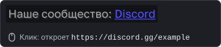
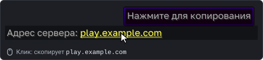
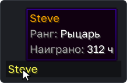
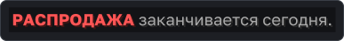
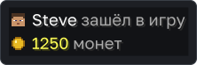

# Сегменты: клики, подсказки и не только

[English](../segments.md) · **Русский** · [← Документация](README.md)

Сегмент — это часть сообщения в квадратных скобках. Круглые скобки сразу после неё перечисляют, что
эта часть делает:

```text
[&a&nСпавн](run:/spawn, show:&7Телепорт на спавн)
 └ текст ┘  └──────────── действия ────────────┘
```


Действия записываются как `имя:значение` и разделяются запятыми. Всё, что вы задали внутри скобок, —
и действия, и цвета, — относится только к этой части.

**На странице:** [клики](#действия-по-клику) · [подсказки](#подсказки-show) ·
[shift-клик](#shift-клик-insert) · [несколько действий](#несколько-действий-сразу) ·
[вложенность](#сегмент-внутри-сегмента) · [скобки без действий](#скобки-без-действий) · [головы и
спрайты](#головы-игроков-и-спрайты) · [шрифты](#шрифты) · [правила записи](#правила-записи) · [все
действия](#все-действия)

## Действия по клику

Сегмент реагирует на клик одним из этих способов.

### `run:` — выполнить команду

```text
&7Ежедневная награда ждёт! [&a\[Забрать\]](run:/reward daily)
```

![Зелёная кнопка \[Забрать\], которая выполняет /reward daily](../images/ru/seg-run.svg)

Команда [выполняется так, будто игрок ввёл её
сам](https://minecraft.wiki/w/Text_component_format#run_command), поэтому у него должно быть право
её использовать.

### `suggest:` — вставить команду в строку чата

```text
&7Ответить игроку &f{player}&7: [&b\[Написать\]](suggest:/msg {player} )
```

![Кнопка \[Написать\] вставляет «/msg Alex » в строку чата](../images/ru/seg-suggest.svg)

Текст появляется в строке чата, игрок дописывает его и нажимает Enter. Пробелы в конце здесь
сохраняются, чтобы можно было сразу печатать дальше.

### `url:` — открыть сайт

```text
&7Наше сообщество: [&9&nDiscord](url:https://discord.gg/example)
```



Перед открытием ссылки игра [спросит игрока, уверен ли
он](https://minecraft.wiki/w/Text_component_format#open_url). Всегда пишите адрес целиком, начиная с
`https://`.

### `copy:` — скопировать текст

```text
&7Адрес сервера: [&e&nplay.example.com](copy:play.example.com, show:&7Нажмите для копирования)
```



### `page:` — перелистнуть книгу

В [написанной книге](https://minecraft.wiki/w/Text_component_format#change_page)
`[&9Дальше »](page:3)` открывает третью страницу.

## Подсказки: `show:`

`show:` показывает подсказку, пока мышь находится над сегментом. В подсказке работает весь формат,
включая плейсхолдеры, а `\n` начинает новую строку:

```text
[&e{player}](show:&6{player}\n&7Ранг: &f{rank}\n&7Наиграно: &f{hours} ч)
```



> [!IMPORTANT]
> Запятая заканчивает действие, а в русском тексте запятые на каждом шагу:
> `show:Нажмите, чтобы открыть` оборвётся на «Нажмите». Текст с запятыми берите в кавычки:
> `show:"Нажмите, чтобы открыть"`. Так же поступайте с закрывающей круглой скобкой: она заканчивает
> весь список действий. Всё остальное внутри кавычек работает как обычно, включая `\n`; обратный
> слэш нужен только перед кавычкой: `\"`.
>
> ```text
> [&e\[?\]](show:"&6Как играть\n&7Добывайте руду, продавайте её, покупайте улучшения")
> ```

## Shift-клик: `insert:`

`insert:` добавляет текст в строку чата, когда игрок кликает с зажатым Shift:

```text
&7Координаты: [&f120 64 -35](insert:120 64 -35, show:&7Shift+клик — вставить в чат)
```

Он принимает только неизменный текст, без плейсхолдеров, и сочетается с любым действием по клику.

## Несколько действий сразу

У сегмента может быть одно действие по клику, подсказка и `insert` одновременно:

```text
[&b{player}](suggest:/msg {player} , show:&7Написать игроку &f{player})
```

Если дать сегменту два действия по клику, сработает только одно: сначала `run`, затем `suggest`,
`url`, `copy` и `page`.

## Сегмент внутри сегмента

Сегменты можно вкладывать друг в друга. Для своего текста побеждают действия внутреннего, а
остальная часть внешнего сохраняет внешние:

```text
[&7Добро пожаловать! Прочитайте [&e&nправила](url:https://example.com/rules) перед игрой.](show:&7Приятной игры на SkyCraft!)
```

Здесь вся строка показывает подсказку, а ссылку открывает только слово «правила».

## Скобки без действий

Скобки, после которых ничего нет, просто удерживают стиль внутри. После `]` текст продолжается тем
цветом и стилем, какие были до `[`:

```text
&7[&c&lРАСПРОДАЖА] &7заканчивается сегодня.
```



## Головы игроков и спрайты

`head:` показывает [голову
игрока](https://minecraft.wiki/w/Text_component_format#Player_Object_Type) вместо текста сегмента, а
`sprite:` — [текстуру](https://minecraft.wiki/w/Text_component_format#Atlas_Object_Type) по её
ключу, например из вашего ресурспака:

```text
[&8?](head:{player}) &f{player}&7 зашёл в игру
[&e$](sprite:myserver:icons/coin) &e{coins} &7монет
```



Текст в скобках — запасной вариант. Если плейсхолдер даёт имя, которого не может быть у игрока,
например с пробелами или русскими буквами, сегмент покажет свой текст вместо головы. Неверное
постоянное имя, как в `head:Steve Jobs`, не даст сообщению загрузиться — будет ошибка.

Спрайты берутся из [атласа блоков](https://minecraft.wiki/w/Atlas#List_of_atlases) игры. В нём уже
есть все текстуры из папок `textures/block/` ресурспака, поэтому
`assets/myserver/textures/block/coin.png` — это `sprite:myserver:block/coin`. Текстуру из другой
папки, как `icons/coin` выше, ресурспак должен сам добавить в атлас — в файле
`assets/minecraft/atlases/blocks.json` ([формат](https://minecraft.wiki/w/Atlas#JSON_format)).
Текстуры предметов вроде `item/diamond` с Minecraft 1.21.11 лежат в отдельном атласе, и использовать
их нельзя.

> [!NOTE]
> Чтобы видеть головы и спрайты, игрокам нужен Minecraft 1.21.9 или новее, а серверу — Adventure
> 4.25 или новее.

## Шрифты

`font:` рисует сегмент другим шрифтом: встроенным в игру, например `uniform` (Юникод-шрифт) или
`alt` (руны стола зачарований), или [шрифтом из вашего
ресурспака](https://minecraft.wiki/w/Resource_pack#Fonts):

```text
[Древние тайны](font:alt)
[{icon}](font:myserver:icons)
```

Имя шрифта — неизменный текст, плейсхолдеры здесь не работают.

## Правила записи

- Действия разделяются запятыми. Пробелы вокруг имён, двоеточий и запятых не важны —
  `run: /spawn , show: привет` сработает, — кроме пробелов в конце значения `suggest:`: там они
  сохраняются специально.
- Имена действий пишутся строчными буквами. `RUN:` не распознаётся, а незнакомые действия молча
  пропускаются.
- Значения с запятой или закрывающей круглой скобкой берите в кавычки, `"…"` или `'…'`:
  `show:"Спавн (безопасная зона)"`. Обратный слэш внутри них нужен только перед кавычкой: `\"`.
- `[` всегда открывает сегмент. Чтобы показать скобку как текст, пишите `\[` и `\]`
  ([Экранирование](escapes.md)).

## Все действия

| Действие | Что делает | Плейсхолдеры | Подробнее |
|---|---|---|---|
| `run:/cmd` | Выполняет команду по клику | ✅ | [↑](#run--выполнить-команду) |
| `suggest:/cmd ` | Вставляет текст в строку чата по клику | ✅ | [↑](#suggest--вставить-команду-в-строку-чата) |
| `url:https://…` | Открывает ссылку по клику | ✅ | [↑](#url--открыть-сайт) |
| `copy:текст` | Копирует текст по клику | ✅ | [↑](#copy--скопировать-текст) |
| `page:2` | Листает книгу по клику | — | [↑](#page--перелистнуть-книгу) |
| `show:текст` | Показывает подсказку | ✅ | [↑](#подсказки-show) |
| `insert:текст` | Вставляет текст по Shift+клику | — | [↑](#shift-клик-insert) |
| `head:имя` | Показывает голову игрока | ✅ | [↑](#головы-игроков-и-спрайты) |
| `sprite:ключ` | Показывает текстуру | — | [↑](#головы-игроков-и-спрайты) |
| `font:ключ` | Другой шрифт | — | [↑](#шрифты) |
| `color:…`, `style:…`, `shadow:…` | Цвет, стиль и тень там, где текст сегмента их не задал | ✅ | [Цвета](colors.md#цвет-для-одной-части-color-и-style) |
| `force-color:…`, `force-style:…`, `force-shadow:…` | Цвет, стиль и тень всего сегмента поверх кодов внутри | ✅ | [Цвета](colors.md#перекрыть-всё-force-color-force-style-force-shadow) |
| `phase:…` | Сдвигает его градиенты вдоль текста | — | [Градиенты](gradients.md#бегущий-градиент) |
| `if:…`, `unless:…` | Показывает только при условии | ✅ | [Условия](conditions.md) |
| `lang:ключ` | Переводит на язык игрока | ✅ | [Переводы](translations.md) |
| `transform:…` | Меняет текст: регистр, числа, длину | — | [Преобразования](transforms.md) |

---

[← Плейсхолдеры](placeholders.md) · [Документация](README.md) · [Градиенты →](gradients.md)
