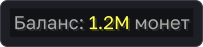

# Преобразования

[English](../transforms.md) · **Русский** · [← Документация](README.md)

`transform:` меняет текст [сегмента](segments.md) прямо перед показом. Полезнее всего это для
значений из плейсхолдеров, которые сами вы поправить не можете:

```text
&7Баланс: &e[{balance}](transform:compact) &7монет
```



## Шаги

| Шаг | Что делает | Пример |
|---|---|---|
| `compact` | Сокращает числа от 1000 | `1234567` → `1.2M` |
| `upper` | ВЕРХНИЙ РЕГИСТР | `Steve` → `STEVE` |
| `lower` | нижний регистр | `Steve` → `steve` |
| `smallcaps` | Капитель — маленькие заглавные | `Steve` → `ꜱᴛᴇᴠᴇ` |
| `max:N` | Оставляет не больше `N` символов | `max:6`: `xXDragonSlayerXx` → `xXDrag` |

Чтобы использовать несколько шагов, возьмите их в кавычки через пробел. Они выполняются слева
направо, а `max` — всегда последним:

```text
[{player}](transform:"smallcaps max:10")
```

## Примеры из жизни

```text
[&6&l{server}]  &7Онлайн: &f[{online}](transform:compact)
&7Топ: &f[{player}](transform:max:8)&7 — &e[{kills}](transform:compact) убийств
[&b{rank}](transform:smallcaps) &f{player}
```


## Как считает `compact`

| Значение | Показ |
|---|---|
| `999` | `999` (меньше 1000 не меняется) |
| `1000` | `1K` |
| `1050` | `1.1K` |
| `1234567` | `1.2M` |
| `999999` | `1M` |
| `-1500` | `-1.5K` |
| `1234.56` | `1.2K` |
| `3500000000` | `3.5B` |

Используются латинские `K`, `M`, `B` и `T` (тысячи, миллионы, миллиарды, триллионы), один знак после
точки и округление половины вверх. Число, приклеенное к буквам, не трогается — ник вроде `Steve1234`
останется как есть, — а все отдельные числа в тексте сокращаются: `1234567 монет и 2000 гемов` →
`1.2M монет и 2K гемов`.

## Полезно знать

- `smallcaps` меняет только латинские буквы `a`–`z`. **Русские буквы**, цифры и символы остаются как
  есть. У буквы `x` нет маленькой заглавной, и она остаётся `x`.
- `max` считает символы во всём сегменте, без учёта цветов, и не добавляет `…`.
- Незнакомые шаги пропускаются, как и `max:0` или `max:` с чем-то кроме числа.
- Преобразования выполняются до [градиента](gradients.md) и [перевода](translations.md), так что
  `[{name}](transform:upper, gradient:#ff5555-#5555ff)` раскрасит текст уже в верхнем регистре.

---

[← Переводы](translations.md) · [Документация](README.md) · [Экранирование →](escapes.md)
