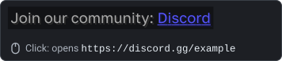
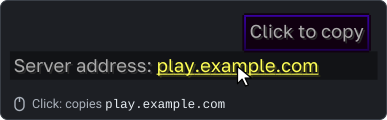
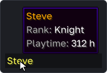
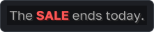

# Segments: clicks, tooltips and more

[← Documentation](README.md)

A segment is a part of the message in square brackets. The parentheses right after it list what that
part does:

```text
[&a&nSpawn](run:/spawn, show:&7Teleport to spawn)
 └ text ─┘  └──────────── actions ─────────────┘
```


Actions are `name:value` pairs separated by commas. Everything you set inside the brackets — the
actions and the colors — applies to that part only.

**On this page:** [clicks](#click-actions) · [tooltips](#tooltips-show) ·
[shift-click](#shift-click-insert) · [combining](#several-actions-at-once) ·
[nesting](#a-segment-inside-a-segment) · [brackets without actions](#brackets-without-actions) ·
[heads and sprites](#player-heads-and-sprites) · [fonts](#fonts) · [rules](#writing-rules) · [all
actions](#all-actions)

## Click actions

A segment reacts to a click in one of these ways.

### `run:` — run a command

```text
&7Your daily reward is ready! [&a\[Claim\]](run:/reward daily)
```

![A green \[Claim\] button that runs /reward daily](images/en/seg-run.svg)

The command [runs as if the player typed
it](https://minecraft.wiki/w/Text_component_format#run_command), so they need permission to use it.

### `suggest:` — type a command into the chat box

```text
&7Reply to &f{player}&7: [&b\[Message\]](suggest:/msg {player} )
```

![A \[Message\] button that puts '/msg Alex ' into the chat box](images/en/seg-suggest.svg)

The text appears in the chat box, and the player finishes it and presses Enter. Spaces at the end
are kept here, so the player can start typing right away.

### `url:` — open a website

```text
&7Join our community: [&9&nDiscord](url:https://discord.gg/example)
```



The game [asks the player to confirm](https://minecraft.wiki/w/Text_component_format#open_url)
before opening the link. Always write the full address, starting with `https://`.

### `copy:` — copy text

```text
&7Server address: [&e&nplay.example.com](copy:play.example.com, show:&7Click to copy)
```



### `page:` — turn a book page

Inside a [written book](https://minecraft.wiki/w/Text_component_format#change_page),
`[&9Next page »](page:3)` turns to page 3.

## Tooltips: `show:`

`show:` displays a tooltip while the mouse is over the segment. The tooltip understands the whole
format, placeholders included, and `\n` starts a new line in it:

```text
[&e{player}](show:&6{player}\n&7Rank: &f{rank}\n&7Playtime: &f{hours} h)
```



> [!IMPORTANT]
> A comma ends the action and a closing parenthesis ends the whole list, so put text that contains
> either in quotes. Everything else works inside quotes as usual, `\n` included; only a quote needs
> a backslash: `\"`.
>
> ```text
> [&e\[?\]](show:"&6How to play\n&7Mine ores, sell them, buy upgrades")
> ```

## Shift-click: `insert:`

`insert:` adds text to the chat box when the player clicks with Shift held:

```text
&7Coordinates: [&f120 64 -35](insert:120 64 -35, show:&7Shift+click to insert)
```

It takes fixed text only, without placeholders, and it can be combined with any click action.

## Several actions at once

A segment can have one click action, a tooltip and `insert` together:

```text
[&b{player}](suggest:/msg {player} , show:&7Click to message &f{player})
```

If you give a segment two click actions, it uses only one of them: `run` first, then `suggest`,
`url`, `copy` and `page`.

## A segment inside a segment

Segments can be nested. The inner one's actions win for its own text, and the rest of the outer
segment keeps the outer actions:

```text
[&7Welcome! Please read the [&e&nrules](url:https://example.com/rules) before you play.](show:&7Have fun on SkyCraft!)
```

Here the whole line shows a tooltip, and only the word "rules" opens a link.

## Brackets without actions

Brackets with nothing after them simply keep a style inside. After `]` the text goes on in the color
and style it had before `[`:

```text
&7The [&c&lSALE] &7ends today.
```



## Player heads and sprites

`head:` shows a [player's head](https://minecraft.wiki/w/Text_component_format#Player_Object_Type)
instead of the segment's text, and `sprite:` shows a
[texture](https://minecraft.wiki/w/Text_component_format#Atlas_Object_Type) by its key, for example
from your resource pack:

```text
[&8?](head:{player}) &f{player}&7 joined the game
[&e$](sprite:myserver:icons/coin) &e{coins} &7coins
```


The text inside the brackets is a backup. If a placeholder gives a name that can't belong to a
player, such as one with spaces or non-Latin letters, the segment shows its text instead of a head.
A fixed name that isn't valid, as in `head:Steve Jobs`, stops the message from loading with an
error.

Sprites come from the game's [block atlas](https://minecraft.wiki/w/Atlas#List_of_atlases). It
already holds every texture in a resource pack's `textures/block/` folders, so
`assets/myserver/textures/block/coin.png` is `sprite:myserver:block/coin`. A texture in another
folder, like `icons/coin` above, has to be added to the atlas by the pack, in
`assets/minecraft/atlases/blocks.json` ([format](https://minecraft.wiki/w/Atlas#JSON_format)). Item
textures such as `item/diamond` live in a separate atlas since Minecraft 1.21.11 and can't be used.

> [!NOTE]
> Players need Minecraft 1.21.9 or newer to see heads and sprites, and the server needs Adventure
> 4.25 or newer.

## Fonts

`font:` draws the segment with another font: one of the game's own, like `uniform` (the Unicode
font) or `alt` (enchanting table runes), or [one from your resource
pack](https://minecraft.wiki/w/Resource_pack#Fonts):

```text
[Ancient secrets](font:alt)
[{icon}](font:myserver:icons)
```

The font name is fixed text; placeholders don't work here.

## Writing rules

- Separate actions with commas. Spaces around names, colons and commas are ignored —
  `run: /spawn , show: hi` works — except at the end of a `suggest:` value, where they're kept on
  purpose.
- Action names are lower case. `RUN:` isn't recognized, and unknown actions are ignored without an
  error.
- Put values that contain a comma or a closing parenthesis in quotes, `"…"` or `'…'`:
  `show:"Spawn (safe zone)"`. Inside them only a quote needs a backslash: `\"`.
- `[` always opens a segment. To show a bracket as text, write `\[` and `\]`
  ([Escaping](escapes.md)).

## All actions

| Action | What it does | Placeholders | Details |
|---|---|---|---|
| `run:/cmd` | Runs a command on click | ✅ | [↑](#run--run-a-command) |
| `suggest:/cmd ` | Puts text into the chat box on click | ✅ | [↑](#suggest--type-a-command-into-the-chat-box) |
| `url:https://…` | Opens a link on click | ✅ | [↑](#url--open-a-website) |
| `copy:text` | Copies text on click | ✅ | [↑](#copy--copy-text) |
| `page:2` | Turns a book page on click | — | [↑](#page--turn-a-book-page) |
| `show:text` | Shows a tooltip | ✅ | [↑](#tooltips-show) |
| `insert:text` | Inserts text on Shift+click | — | [↑](#shift-click-insert) |
| `head:name` | Shows a player's head | ✅ | [↑](#player-heads-and-sprites) |
| `sprite:key` | Shows a texture | — | [↑](#player-heads-and-sprites) |
| `font:key` | Uses another font | — | [↑](#fonts) |
| `color:…`, `style:…` | Colors the segment | ✅ | [Colors](colors.md#coloring-one-part-color-and-style) |
| `gradient:…`, `phase:…` | Fills it with a gradient | — | [Gradients](gradients.md) |
| `if:…`, `unless:…` | Shows it only when a condition holds | ✅ | [Conditions](conditions.md) |
| `lang:key` | Translates it to each player's language | ✅ | [Translations](translations.md) |
| `transform:…` | Changes its text: case, numbers, length | — | [Transforms](transforms.md) |

---

[← Placeholders](placeholders.md) · [Documentation](README.md) · [Gradients →](gradients.md)
